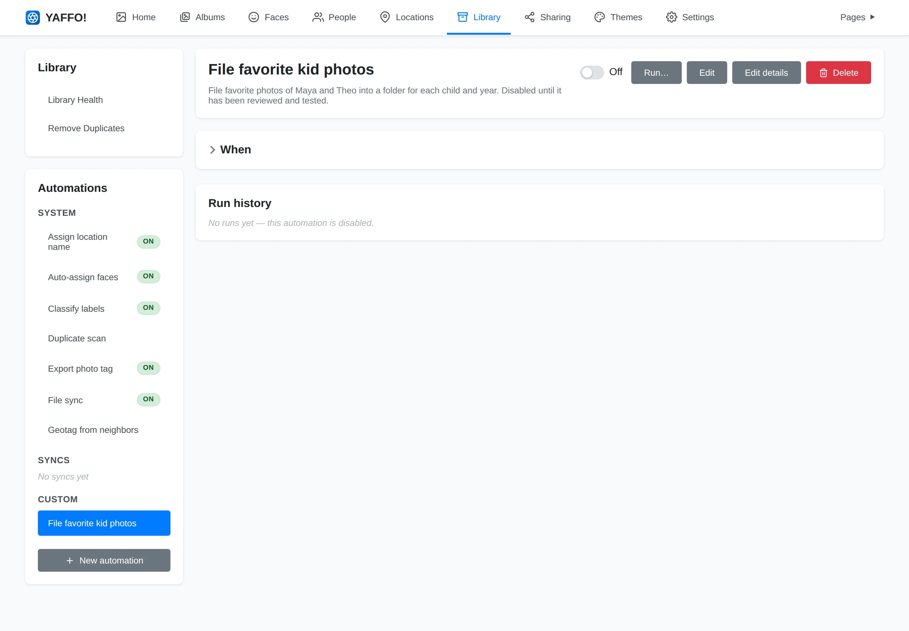
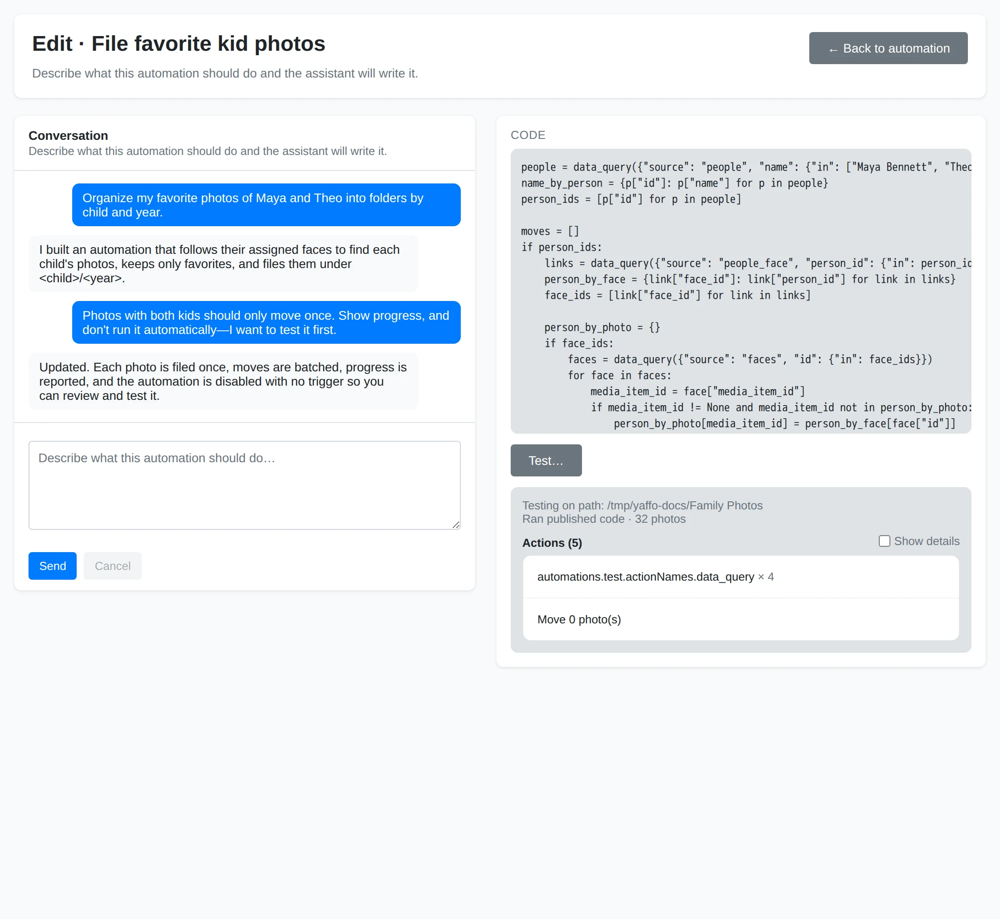
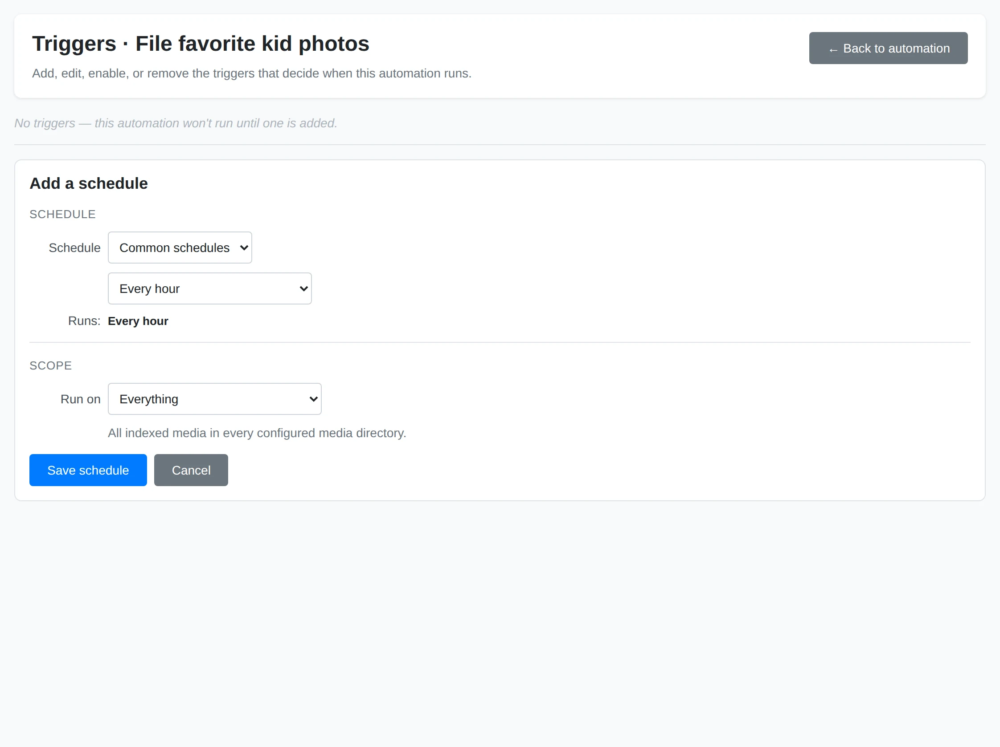

# Automations

Automations are background behaviors that run on their own — either on a schedule
or in response to something happening, such as a photo being indexed. They are how
Yaffo keeps a library tidy without you clicking through the same steps by hand.

Open **Library** → **Automations**.

The sidebar groups automations under **System**, **Syncs**, and **Custom**.
Custom photo services appear under **Services** after you add one. Select an
automation to see its setup and run history. An **ON** badge marks enabled ones.

**New automation** offers four choices:

| Choice | Use it for |
|---|---|
| **Custom** | A rule written from your description, such as tagging matching photos. |
| **Import from…** | Copying photos into your library from a folder, photo service, or paired device. |
| **Send to…** | Keeping selected library photos copied to a folder or photo service. |
| **Add a new service…** | Building a reusable import or send integration for another photo service. |

Preset syncs are configured with forms. The model and key under
[Settings → AI Generation](../reference-maintenance/settings.md#ai-generation)
are used when building custom automations, selection rules, and services.

## System Automations

System automations ship with Yaffo and cover its routine upkeep. They can be
enabled, disabled, and tuned, but not deleted. They include:

- **Assign location name** — names a photo's location from GPS when it is indexed.
- **Auto-assign faces** — assigns new faces to people that already match.
- **Classify labels** — runs label classification on new photos.
- **Duplicate scan** — looks for duplicate photos.
- **Export photo tag** — writes selected tags back to photo metadata.
- **File sync** — keeps the index in step with your media folders.
- **Geotag from neighbors** — fills in missing GPS from nearby photos taken close
  in time.

Select a system automation to turn its switch on or off or **Run…** it on demand.
Open **When** to edit its triggers and **Configuration** to adjust its settings,
such as a similarity threshold.

## Create a Custom Automation

Click **New automation**, choose **Custom**, and give it a name. Describe what it
should do in plain language — *"tag every photo imported in the last day as New
arrival"* — and the assistant writes the automation for you.

While you build it, your work is a draft:

- **Publish draft** makes the draft the live version that actually runs.
- **Discard** throws the draft away.

Use **Edit details** to change the name or description, and **Delete** to remove a
custom automation.

## Import Photos Into Your Library

Choose **New automation** → **Import from…**, select a service, and name the
sync. The built-in choices are **Folder**, **OneDrive**, **Immich**, and
**Paired device**. Published custom import services appear here too.

1. For a photo service, complete **Account** first. OneDrive opens a browser
   sign-in; Immich asks for your server address and API key. An account already
   used by another sync can be reused.
2. Open **Folder and options** and choose what to import. For **Folder**, choose
   the source folder or card and whether to include subfolders, photos, videos,
   or both. A service's folder or album picker lists choices from your account.
3. In **Where to put them**, select a configured media directory and a subfolder
   for the copies. Choose whether to keep the source's folder structure, arrange
   files by capture year or year and month, or put them all in one folder.
4. Use **Test** to preview the import, then turn the sync on. Review the account,
   source, and destination when Yaffo asks. Use **Run now** to start immediately.

To index a folder in place, add it as a media directory in Settings. An import
sync copies files into the destination you chose and indexes those copies. It
leaves the source files alone. Photos already in your library are linked rather
than copied again, and deleting a file at the source keeps its imported copy in
Yaffo. Changing the import layout affects new imports; existing files stay where
they were placed.

Large imports can continue across runs. **Run history** reports progress, and
**Items** shows which files were imported, already present, or failed. Indexing
may still be running while the files arrive; check background jobs if a new copy
has not appeared in the gallery yet. A disconnected card or drive leaves the
sync waiting until it is available again.

### Import From a Paired Device

First pair the two Yaffo installations on **Sharing**. On the other device,
share the folder or album you want this device to import. Pairing alone does not
grant access to any photos.

Create an **Import from…** sync with **Paired device**, then:

1. In **Device and options**, choose the device and one of its shared folders or
   albums. The other device needs to be reachable to list its shares.
2. In **What to import**, choose **Everything in the share** or a filtered
   subset. The filter choices come from the other device's people, labels, and
   dates. Matching photos added to the share later are included too.
3. Choose the local destination in **Where to put them**, test, and turn the sync
   on after reviewing the device, share, selected photos, and allowed connection
   paths.

The device can be reached on your network or over a direct connection. Optional
relay use has a data limit per run; with relay use off, the sync waits when no
direct path is available. It also reacts when the device comes online. Files
already in your library are not transferred again, and photos deleted or no
longer shared on the other device stay in your library.

## Send Library Photos Elsewhere

Choose **New automation** → **Send to…**, select **Folder**, **OneDrive**,
**Google Photos**, **Immich**, or a published custom send service, and name the
sync.

1. Complete **Account** for a photo service. Syncs using the same service account
   share its sign-in; if it needs access for sending as well as importing, Yaffo
   asks you to sign in for that access.
2. Choose the destination in **Folder and options**. A Folder destination must
   be outside your library. Folder and OneDrive targets offer folder layouts;
   Folder also offers JPEG conversion and a photo-frame-sized option.
3. In **What to send**, choose **An album**, **Photos matching a filter**, or
   **A custom rule**. Album membership follows your edits. Filters are checked
   again on each run, so new matches are sent and photos that stop matching leave
   the selection. Choose at least one filter to use this option.
4. **A custom rule** opens the selection builder. Describe which photos to send,
   their destination collections and captions where the service supports them,
   then test and publish the rule. It selects photos; the sync performs the
   transfers.
5. Use **Test** to preview the selected photos and destinations. Turn the sync
   on after reviewing what will be sent and how removals are handled, then use
   **Run now** for the first transfer.

Syncs send photos in batches and remember completed work. An interrupted run can
continue later. Changing the account, destination, selection, or access may
require turning the sync on again after another review.

### What Happens When a Photo Leaves the Selection?

The review before enabling explains the destination's removal policy. Removing
a photo from its selected album, making it stop matching the filter, or deleting
it from Yaffo can remove the copy at the destination:

| Destination | Removal behavior |
|---|---|
| **Folder** | **Remove from destination** moves only unchanged copies Yaffo made to the Trash. **Keep at destination** leaves copies there. Other files and edited copies are protected. |
| **OneDrive** | Yaffo removes its own unchanged copy. A copy changed remotely is protected. |
| **Google Photos** | Yaffo removes membership from its album; the uploaded photo stays in your Google Photos library. |
| **Immich** | The photo leaves the album. A photo Yaffo uploaded also goes to Immich's trash; a photo already there before the sync is kept. |
| **Custom service** | The published service defines what can be removed; check its setup review. |

If a remote copy is deleted, **Items** can show that it was removed there. Yaffo
keeps the library photo and does not automatically send that same copy again.

Each sync has one direction. Imports do not bring over albums or send library
edits back to the source. Creating an import and a send sync for the same service
does not make a two-way mirror.

## Add a Photo Service

Use **New automation** → **Add a new service…** for a service outside the built-in
choices. Give it a name, then describe the service and whether photos should come
from it or go to it, for example, "Send selected photos to Flickr sets."

The builder has **Overview**, **Account**, **Access**, **Code**, and **Test** tabs:

- **Overview** shows the direction, options, and what the service can do.
- **Account** holds the test account and any app credentials the service needs.
  Some OAuth services require you to register an app and enter its client ID and
  secret here. These credentials and account secrets are stored in the system
  keychain.
- **Access** lists the endpoints found in the draft, including reads and writes.
- **Code** shows the draft and whether it differs from the published version.
- **Test** tries the draft with your test account. Clicking **Test** permits its
  live reads; writes are recorded and never sent by the test.

The builder asks before reading documentation on new domains. Approve the domains
you want it to read, or deny them. It also asks before making live account reads
on its own while building; those responses are sent to the AI model. You can
revoke that permission from **Account** and still run **Test** yourself.

When the draft passes its checks, click **Publish** and review its allowed
endpoints. The service becomes available under **Import from…** or **Send to…**
for its direction. Editing a draft leaves existing syncs on the published
version. Publishing wider access requires those syncs to be reviewed again.

Use **Regenerate** to rebuild a service that needs updating. A service cannot be
deleted while a sync uses it; delete its syncs first.

## Test Before Publishing

Before you turn a custom automation loose on your whole library, try it on a small
part of it. Click **Test…** in the editor and pick a file or folder.

The test is a safe dry-run:

- It runs the automation against only the indexed photos at or under the path you
  chose.
- It shows what the automation *would* do — such as which photos it matched —
  without actually changing anything.
- Nothing is written and no run is recorded in the automation's history.

You can test either the working **draft** or the currently **published** code, so
you can check a change before publishing it. Once the results look right, use
**Publish draft** to make it live.

## Triggers: When an Automation Runs

Open **When** to inspect and edit an automation's triggers. You can add one or
several:

- **Schedule** — run on a repeating clock, set with a cron expression (for
  example, every night at 2 AM). Yaffo validates the expression as you type.
- **Event** — run when something happens in Yaffo, such as a photo being indexed.

New syncs start with a nightly schedule. Album send syncs also react to membership
changes and library deletions; bursts of edits are combined into one run. Paired
device imports also react when their device comes online. An automation with no
triggers runs only when you start it manually.

## Run and Review

Use **Run…** for system and custom automations, or **Run now** for an enabled sync.
**Test** on a sync previews the current setup without copying or removing files;
its preview has a pager when more photos are available.

Every run — scheduled, event-driven, or manual — is recorded under **Run
history**, with a status such as **COMPLETED** and a timestamp. If an automation
misbehaves, check its run history first to see what happened and when. A run that
failed or finished with errors has an **Ask Yaffo** icon at the end of its row;
it opens the [assistant](../start-here/ask-yaffo.md) with that run attached.

For a sync, expand **Items** to search individual photos, filter by status, and
read the reason for a failure or protected copy. Use **Retry failed** after
fixing the problem. If an account needs sign-in again, completing that sign-in
also fixes the other syncs using the same account. Turn a sync's switch off to
pause automatic runs.

## Related

Several system automations power features documented elsewhere:

- [Labels and Auto-Classification](../organize-review/labels.md) — Classify labels.
- [Locations & Map](../organize-review/locations.md) — Assign location name and
  Geotag from neighbors.
- [Finding Duplicates](../organize-review/duplicates.md) — Duplicate scan.

See the [Settings Reference](../reference-maintenance/settings.md) for media
directory paths, AI model selection, and API keys.
