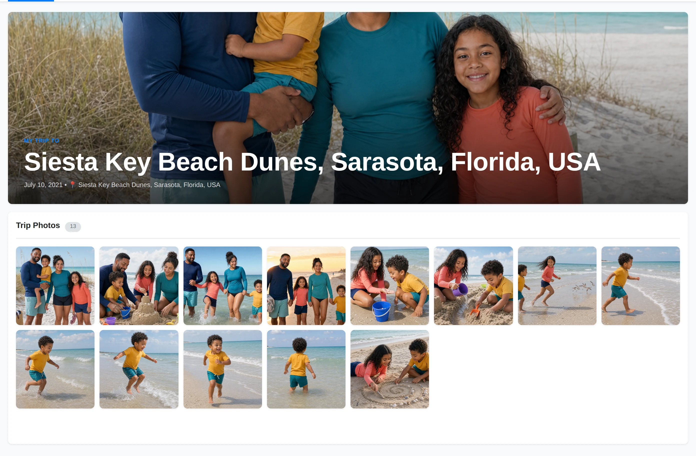
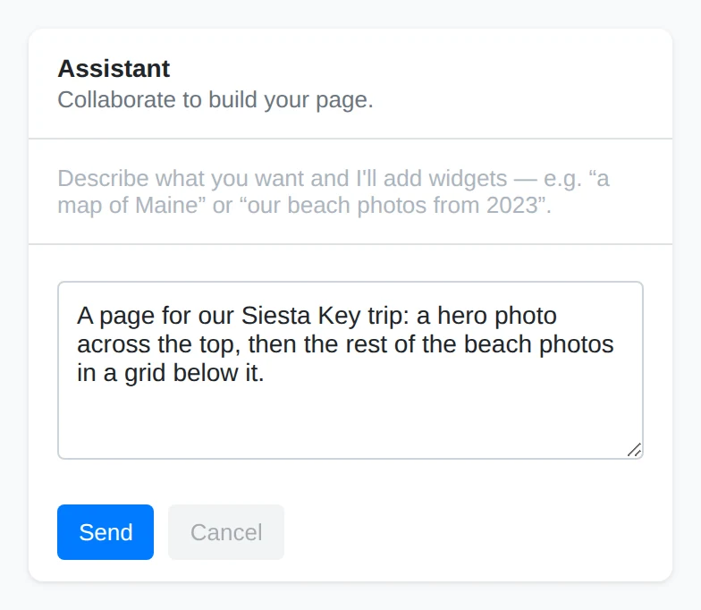
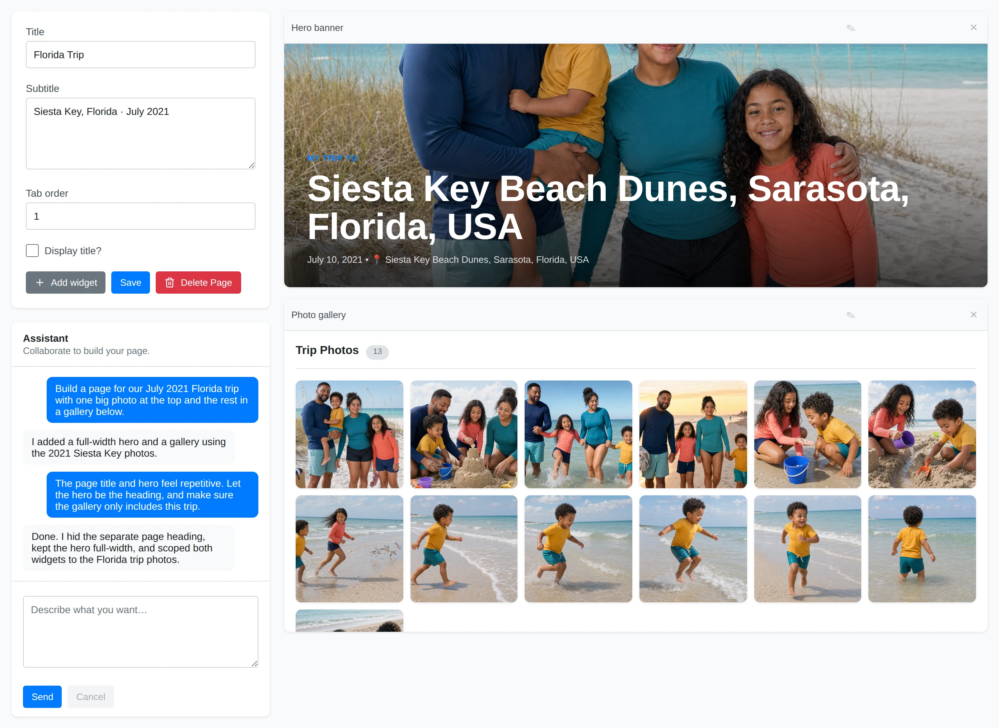

# Custom Pages

Custom pages turn library data into your own dashboards, trip stories, maps,
galleries, and other presentations. Each page appears on the **Pages** strip
below the main navigation. A page with saved widgets opens in presentation mode;
the pencil beside its tab takes you back to the design view that built it.

## Explore the Page

### Hero Widget

A hero banner widget owns the whole width of the page: one photo, a heading, and
a caption line. The widget supplies its own heading here, so the page needs no
separate title bar.

### Gallery Widget

A gallery widget sits under the hero with a count and a thumbnail grid. Each
widget is a separate frame, so it loads, reflows, and can be replaced without the
rest of the page following it.

## Create a Page

Click **+ New page** on the Pages strip. Yaffo creates an **Untitled Page**
immediately and opens its design view — an empty canvas with the page settings
and the Assistant on the left. Nothing is published yet: a page with no saved
widgets keeps opening in the design view, so you can come back and edit it
whenever you like. A page with saved widgets opens in presentation mode instead.

The strip can be folded away with **Pages ▾**. The fold is remembered across
sessions, so if you cannot see any tabs, that is the first thing to open.

## Build a Page with the Assistant

One sentence is usually enough. Yaffo picks widgets from its catalog, arranges
them on the 12-column canvas, and keeps the result in a working version until you
save it. AI generation needs a model and its API key — see **Settings** →
**AI Generation** — and the steps below assume one is configured.

### Start a New Page

Click **+ New page** at the end of the Pages strip. The new tab appears at once
and the design view opens on an empty grid: **Title** still reads *Untitled
Page*, the canvas has no widgets, and the Assistant is waiting with its
example prompts.

Name the page here if you already know it. The title is only written when you
click **Save**, which is the last step.

### Describe the Page to the Assistant

Type what the page is for into the box under **Assistant** — the occasion, the
photos, and the shape you want, for instance *a hero photo across the top, then
the rest of the beach photos in a grid below it*. Click **Send** when it reads the
way you mean. Naming the photos, a place, or a year is what the widgets will
select on.

### Watch Generation Run

The canvas locks while the model works. **Add widget** and **Save** grey out,
the message box and **Send** are disabled, and a **Generating…** bar appears
with an elapsed timer. Widget headers keep only their order and size arrows,
because nothing may be moved or removed mid-run. **Cancel** stays available.

The run does not need the browser. It lives in the working version on the
server, so closing or reloading the tab does not interrupt it; reopen the page
and the timer is still counting.

### Review the Draft

When the run succeeds the draft becomes yours again. The grid unlocks, the widget
headers get their pencil and **×** back, **Add widget** and **Send** re-enable,
and **Save** goes live. Move a widget by its header, resize it from its corner,
rename it with the pencil, or describe a change in the Assistant and send it — a
follow-up re-runs on the same working version, not a new page.

Nothing has been published yet. The published page, if there is one, is
untouched while you work on the draft.

### Save the Page

Click **Save**. On a page whose draft is ready, this publishes the working
version and opens the page in presentation mode. On a page you are editing by
hand, it commits the title, subtitle, tab order and layout, then opens the same
view.

Until you click **Save**, manual moves live only in this browser tab. Closing
the tab before saving loses them.

### See the Published Page

The page opens in presentation mode: the same grid, laid out the same way, with
no editing controls and no frames around the widgets. If **Display title?** is
ticked, the page title and subtitle appear above the grid. The tab is now active
in the Pages strip, with a pencil beside it that leads back to the design view.

## Explore the Design View

### Page Settings

- **Title** and optional **Subtitle** fields;
- **Tab order**, which sets the page's position among other custom-page tabs;
- **Display title?**, which controls whether presentation mode adds a separate
  page heading above the widgets;
- **Add widget**, **Save**, and **Delete Page** actions.

Click **Save** to commit page settings and manual layout changes.

### Assistant

Describe the page or widget you want, and the Assistant builds or changes it.
[Read about generating a page](#generate-and-refine-a-page).

### Widget Controls

Each widget's header has its title, a pencil to rename it, and **×** to remove
it. Drag the header to move the widget.
[Read about widgets](#work-with-widgets).

### Canvas

The canvas is a responsive grid laid out on 12 columns. It reflows to six
columns and then to a single full-width column as the canvas narrows, but
**Save** always commits the 12-column layout.

## Work with Widgets

A widget is an independently rendered block with its own title, data request,
layout, and presentation code. Widgets run in isolated frames. Yaffo validates
and resolves their library queries on the server, so generated widget code does
not receive direct database or network access.

Click **Add widget** to add a blank widget manually. Use its pencil to rename it,
drag its header to move it, drag its resize handle to change its size, or click
**×** to remove it after confirming. The header also carries **↑**, **↓**, **−**,
and **＋** buttons that move a widget up or down the page and make it shorter or
taller. They appear when you hover a widget, and stay visible wherever dragging
is unavailable — on a touch screen, or on a canvas narrow enough to be a single
column. The blank widget has no generated content; use the Assistant when you
want Yaffo to design a functional widget.

The Assistant can use or adapt these built-in widget patterns:

- **Hero banner** — a full-width focal image and heading;
- **Photo grid** — a simple responsive thumbnail grid;
- **Photo gallery** — a polished gallery with captions and a lightbox;
- **Library stats** — photo, people, and year summary tiles;
- **Featured photo** — one full-bleed image with a caption;
- **Filterable gallery** — a gallery with its own year filter;
- **People** — person selectors and their associated photos;
- **Photo map** — an interactive map of geotagged photos;
- **Filter controls** and **Linked gallery** — a connected pair where filters
  update one or more galleries;
- **Photo picker** and **Photo spotlight** — a connected selector and featured
  photo pair;
- **Folder picker** and **Folder gallery** — a connected folder browser and
  gallery pair.

This catalog gives the Assistant reliable starting points; it can combine,
filter, restyle, or create other widget designs for your request.

## Generate and Refine a Page

AI generation requires a configured provider and API key under **Settings** →
**AI Generation**.

1. Describe the page or widget in the Assistant box and click **Send**.
2. Yaffo creates a durable working version and starts generation in the
   background.
3. While generation is running, the grid, Add widget, and Send controls are
   locked. The elapsed timer and conversation show progress. **Cancel** discards
   the working version after confirmation.
4. When generation succeeds, the grid unlocks so you can review, move, resize,
   rename, or request follow-up changes.
5. Click **Save** to publish the ready version.

Closing or reloading the browser does not discard an active generation because
the working version is stored by Yaffo. If generation fails, the draft becomes
editable for a retry or follow-up, and **Save** stays disabled until a later run
succeeds; a failed draft is never published.

## Present and Edit a Page

Presentation mode shows the published version in a static grid without editing
controls. If **Display title?** is enabled, the page title and subtitle appear
above the grid. A widget can also provide its own heading, as the seeded Florida
Trip page does.

Open a page from the Pages strip. When its tab is active in presentation mode,
click the pencil beside the tab to return to design mode.

Manual changes to the published page remain in the browser until **Save**. AI
changes remain in a separate working version until **Save** publishes them. This
keeps a partially generated draft from replacing the current presentation.

## Delete a Page

Open design mode and click **Delete Page**. Yaffo asks for confirmation and names
the page that will be removed. Deleting a page removes its versions, widgets, and
conversation, then removes its tab from the Pages strip.

## When a Page Will Not Build

### The Message Is Refused

A notification naming a provider means no API key is saved for the active model.
Nothing was stored, so the page is exactly where you left it: add the key in
[Settings → AI Generation](../reference-maintenance/settings.md#ai-generation)
and send the same message again.

### The Run Never Ends

An elapsed timer that keeps counting is a run that is still going. Leave the tab
if you like — the work continues on the server — or click **Cancel** and confirm;
the working version is discarded and the page snaps back to its published
version. If sending another message is refused because a generation is already
running, cancel the run first.

### Save Stays Greyed Out

**Save** is disabled while a run is active, and on a draft that failed. A failed
draft is editable — move widgets, describe the fix in the Assistant, send it —
but it cannot be published as it stands. Finish or cancel the run, then retry.

For how custom pages fit alongside filters, favorites, albums, and tags, see
[Organizing Photos](../library-basics/organizing-photos.md). To restyle the whole
app, including custom pages and widgets, see [Themes](themes.md).
