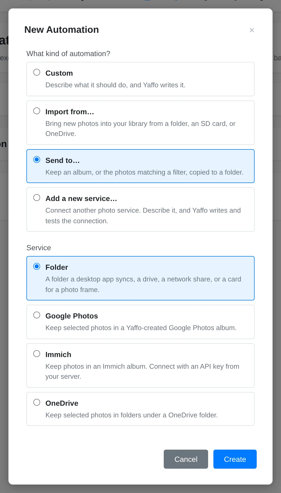
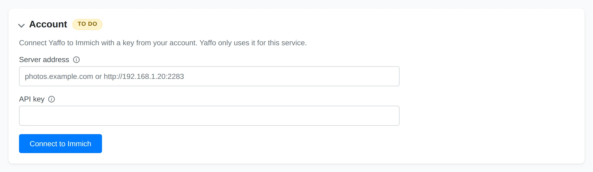
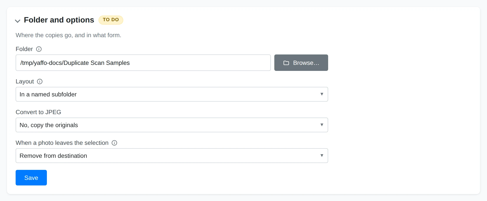
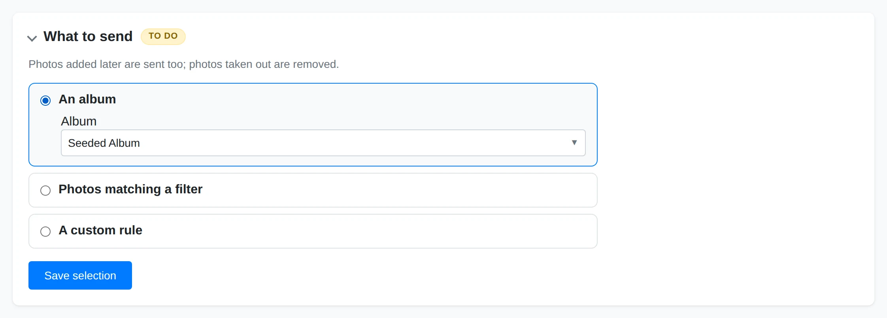
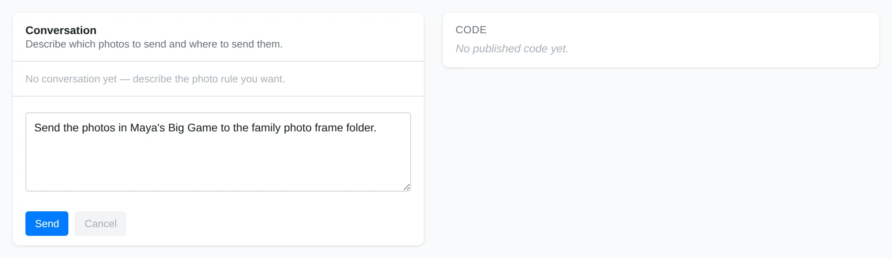
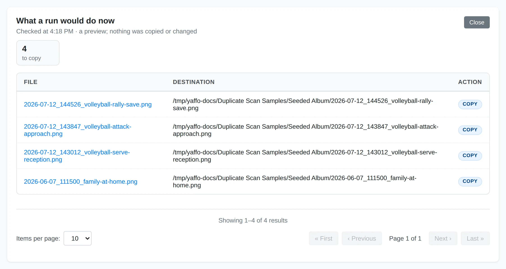
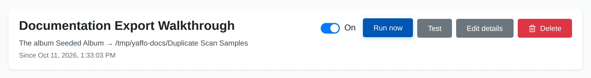
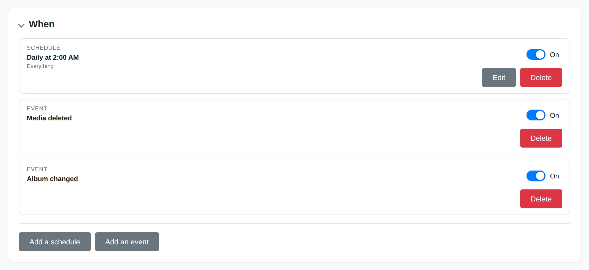
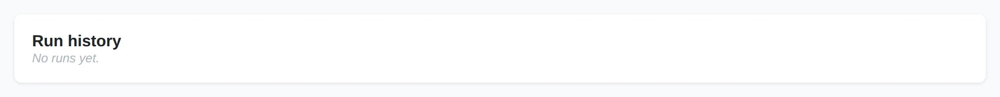

# Exporting Photos

Open **Library** → **Automations** to create a sync. This walkthrough takes you
through setup, preview, and the first run.

Choose **New automation** → **Send to…**, select **Folder**, **OneDrive**,
**Google Photos**, **Immich**, or a published custom send service, and name the
sync.

1. For a photo service, complete **Account** first. Syncs using the same service account
   share its sign-in; if it needs access for sending as well as importing, Yaffo
   asks you to sign in for that access.

   
2. Choose the destination in **Folder and options**. A Folder destination must
   be outside your library. Folder and OneDrive targets offer folder layouts;
   Folder also offers JPEG conversion and a photo-frame-sized option.

   
3. In **What to send**, choose **An album**, **Photos matching a filter**, or
   **A custom rule**. Album membership follows your edits. Filters are checked
   again on each run, so new matches are sent and photos that stop matching leave
   the selection. Choose at least one filter to use this option.

   
4. **A custom rule** opens the selection builder. Describe which photos to send,
   their destination collections and captions where the service supports them,
   then test and publish the rule. It selects photos; the sync performs the
   transfers.

   
5. Use **Test** to preview the selected photos and destinations. Turn the sync
   on after reviewing what will be sent and how removals are handled, then use
   **Run now** for the first transfer.

   

   After enabling the sync, **Run now** is available for the first transfer.

   

Syncs send photos in batches and remember completed work. An interrupted run can
continue later. Changing the account, destination, selection, or access may
require turning the sync on again after another review.

## What Happens When a Photo Leaves the Selection?

The review before enabling explains the destination's removal policy. Removing
a photo from its selected album, making it stop matching the filter, or deleting
it from Yaffo can remove the copy at the destination:

| Destination | Removal behavior |
|---|---|
| **Folder** | **Remove from destination** moves only unchanged copies Yaffo made to the Trash. **Keep at destination** leaves copies there. Other files and edited copies are protected. |
| **OneDrive** | Yaffo removes its own unchanged copy. A copy changed remotely is protected. |
| **Google Photos** | Yaffo removes membership from its album; the uploaded photo stays in your Google Photos library. |
| **Immich** | The photo leaves the album. A photo Yaffo uploaded also goes to Immich's trash; a photo already there before the sync is kept. |
| **Custom service** | The published service defines what can be removed; check its setup review. |

If a remote copy is deleted, **Items** can show that it was removed there. Yaffo
keeps the library photo and does not automatically send that same copy again.

Each sync has one direction. Imports do not bring over albums or send library
edits back to the source. Creating an import and a send sync for the same service
does not make a two-way mirror.

## Schedule and Monitor the Sync

New syncs start with a nightly schedule. Open **When** to adjust it; with no
triggers, the sync runs only when you start it manually. Album send syncs also react to membership changes and library deletions.

Check **Run history** for progress. Expand **Items** to search photos, filter
statuses, and read failure reasons. Fix the problem before using **Retry failed**.
If an account needs sign-in again, reconnecting also fixes other syncs using the
same account. Turn the sync off to pause automatic runs. Changes to setup or
access can require another review before turning it on again.

## Related

- [Automations](automations.md) — triggers, run history, and custom rules.
- [Creating a Photo Service](photo-services.md) — add a service outside the built-in choices.
- [Importing Photos](importing.md) — copy photos into your library.
