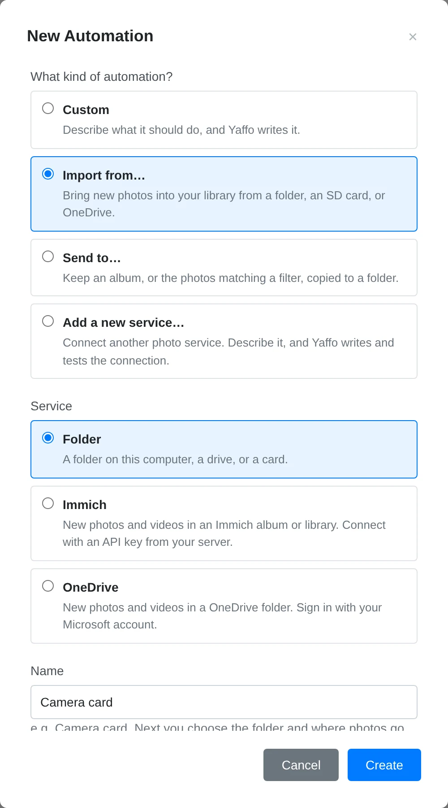
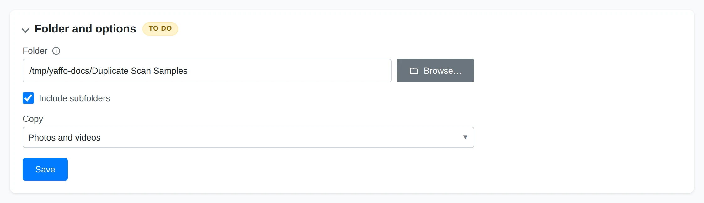
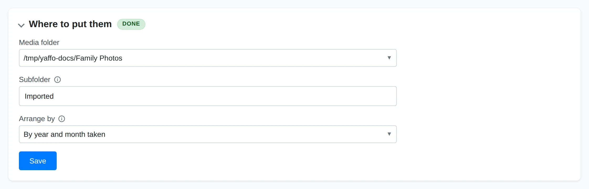
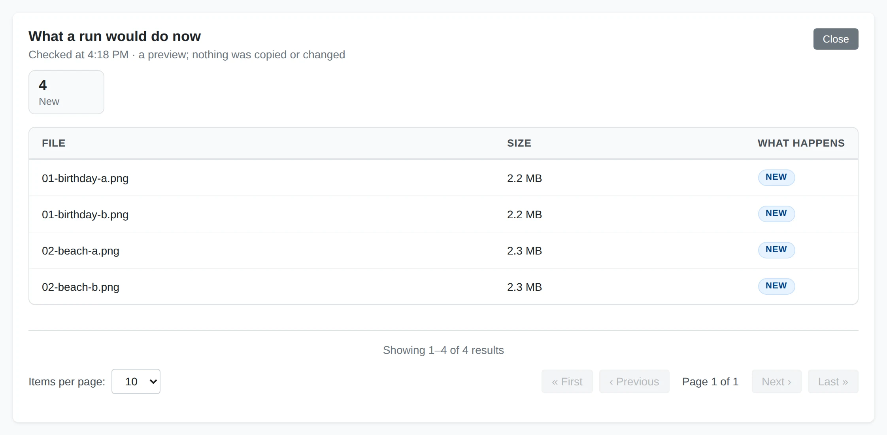

# Importing Photos

Open **Library** → **Automations** to create a sync. This walkthrough takes you
through setup, preview, and the first run.

Choose **New automation** → **Import from…**, select a service, and name the
sync. The built-in choices are **Folder**, **OneDrive**, **Immich**, and
**Paired device**. Published custom import services appear here too.

1. For a photo service, complete **Account** first. OneDrive opens a browser
   sign-in; Immich asks for your server address and API key. An account already
   used by another sync can be reused.
2. Open **Folder and options** and choose what to import. For **Folder**, choose
   the source folder or card and whether to include subfolders, photos, videos,
   or both. A service's folder or album picker lists choices from your account.

   

3. In **Where to put them**, select a configured media directory and a subfolder
   for the copies. Choose whether to keep the source's folder structure, arrange
   files by capture year or year and month, or put them all in one folder.

   

4. Use **Test** to preview the import, then turn the sync on. Review the account,
   source, and destination when Yaffo asks. Use **Run now** to start immediately.

To index a folder in place, add it as a media directory in Settings. An import
sync copies files into the destination you chose and indexes those copies. It
leaves the source files alone. Photos already in your library are linked rather
than copied again, and deleting a file at the source keeps its imported copy in
Yaffo. Changing the import layout affects new imports; existing files stay where
they were placed.

Large imports can continue across runs. **Run history** reports progress, and
**Items** shows which files were imported, already present, or failed. Indexing
may still be running while the files arrive; check background jobs if a new copy
has not appeared in the gallery yet. A disconnected card or drive leaves the
sync waiting until it is available again.

## Import From a Paired Device

First pair the two Yaffo installations on **Sharing**. On the other device,
share the folder or album you want this device to import. Pairing alone does not
grant access to any photos.

Create an **Import from…** sync with **Paired device**, then:

1. In **Device and options**, choose the device and one of its shared folders or
   albums. The other device needs to be reachable to list its shares.
2. In **What to import**, choose **Everything in the share** or a filtered
   subset. The filter choices come from the other device's people, labels, and
   dates. Matching photos added to the share later are included too.
3. Choose the local destination in **Where to put them**, test, and turn the sync
   on after reviewing the device, share, selected photos, and allowed connection
   paths.

The device can be reached on your network or over a direct connection. Optional
relay use has a data limit per run; with relay use off, the sync waits when no
direct path is available. It also reacts when the device comes online. Files
already in your library are not transferred again, and photos deleted or no
longer shared on the other device stay in your library.

## Schedule and Monitor the Sync

New syncs start with a nightly schedule. Open **When** to adjust it; with no
triggers, the sync runs only when you start it manually. Paired-device imports also react when their device comes online.

Check **Run history** for progress. Expand **Items** to search photos, filter
statuses, and read failure reasons. Fix the problem before using **Retry failed**.
If an account needs sign-in again, reconnecting also fixes other syncs using the
same account. Turn the sync off to pause automatic runs. Changes to setup or
access can require another review before turning it on again.

## Related

- [Automations](automations.md) — triggers, run history, and custom rules.
- [Creating a Photo Service](photo-services.md) — add a service outside the built-in choices.
- [Exporting Photos](exporting.md) — send selected library photos elsewhere.
