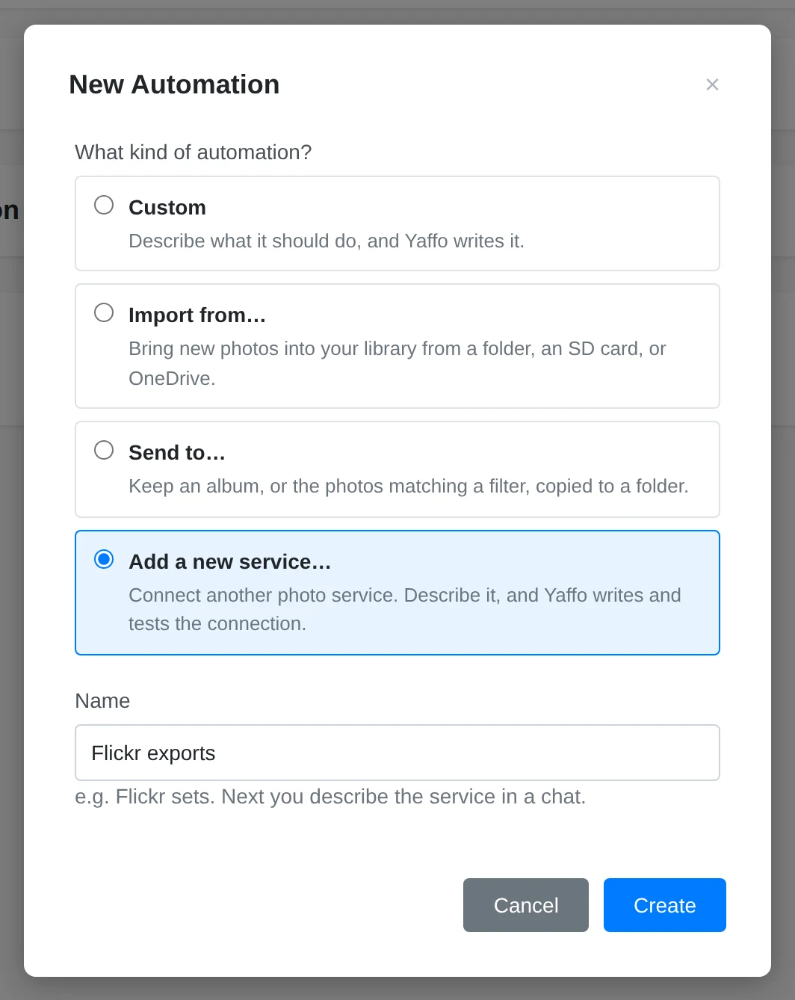
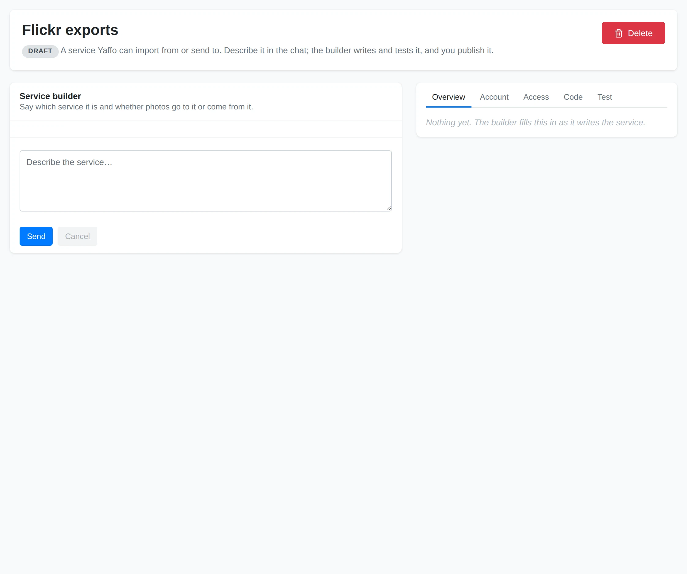

# Creating a Photo Service

Build a photo service when the service you want is missing from **Import from…**
or **Send to…**. A service is a reusable connection; after publishing it, you
create a sync to choose which photos to import or send and when it runs.

This walkthrough uses sending selected photos to Flickr sets as an example.
You can describe another service or an import instead.

## 1. Prepare the Builder

Save a model and its provider key in
[Settings → AI Generation](../reference-maintenance/settings.md#ai-generation).
The builder uses this model to write the connection from your description.

Open **Library** → **Automations**, click **New automation**, choose
**Add a new service…**, and name it, for example **Flickr exports**.

### Add a New Service

Choose this to build a reusable connection instead of a sync.

### Name

A name for the service, such as **Flickr exports**.

### Create

Opens the service builder.

## 2. Describe the Connection

Tell the builder what service to connect and which direction photos should travel:

> Send selected photos to Flickr sets. Let me choose a destination set.

Include any options you need, such as choosing an album or keeping captions.
Review **Overview** as the draft develops: it shows the direction, sign-in method,
options, and supported actions.

### Draft Badge

The service stays a draft until you publish it.

### Service Builder

Describe the service and the direction photos travel. The builder writes the connection from your description.

### Builder Tabs

**Overview** summarizes the draft. **Account**, **Access**, **Code**, and **Test** cover the next steps. [Read about connecting an account](#3-connect-a-test-account) and [testing](#4-review-and-test-the-draft).

### Delete

Removes the service. It is unavailable while a sync uses it.

The builder asks before reading documentation on new domains. Review the domains
and approve those you want it to read, or deny the request.

## 3. Connect a Test Account

Open **Account** once the builder has identified the sign-in method.

If **App credentials** appears, register an app with the photo service and copy
the displayed return address into its app configuration. Save the requested
client ID and secret. These credentials identify the app and are reused by syncs
using this service. Changing them signs those syncs out.

Under **Test account**, sign in or enter the requested account credentials. This
is the account used for testing and can also be reused when you create a sync.
App credentials and account secrets are stored in your system keychain.

The builder separately asks before making live account reads while building.
If approved, the responses go to the AI model. Use **Revoke** in **Account** to
withdraw this permission. You can still run **Test** yourself.

## 4. Review and Test the Draft

Open **Access** to inspect the endpoints found in the code, including which calls
read data and which write it. **Code** shows the draft and, after publication,
whether it differs from the published version.

Open **Test**, fill in any options, and click **Test**. This permits live reads
from your test account. Writes are recorded and never sent: the test does not
upload, change, or delete photos. For an album or set option, leave it empty to
list available choices, then test again with an ID from the results.

Review the results and describe any problems to the builder. It sees the test
result with your next message. Repeat until the draft behaves as you expect.

## 5. Publish and Create a Sync

When the draft passes its checks, click **Publish** and review the allowed
endpoints before approving publication.

Return to **New automation**. The published service now appears under
**Send to…** for a send service or **Import from…** for an import service.
Choose it and complete the account, photo selection, options, and setup review
described in [Automations](automations.md). Publishing the service alone does not
start copying photos.

## Update or Remove the Service

Select the service under **Services** to continue editing it. Existing syncs use
the published version while you work on a draft. Publishing wider access requires
those syncs to be reviewed again.

Use **Regenerate** to rebuild a service that needs updating. To delete a service,
delete any syncs using it first; **Delete** is unavailable while it is in use.
