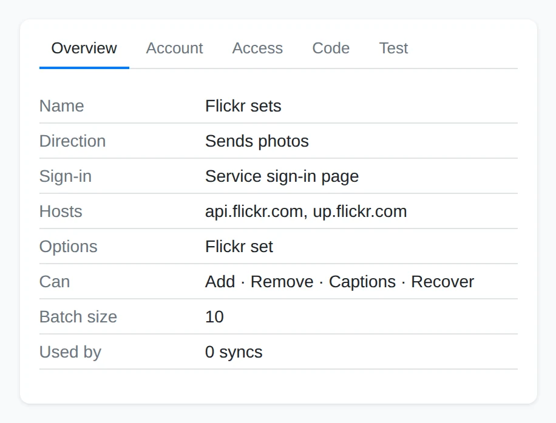
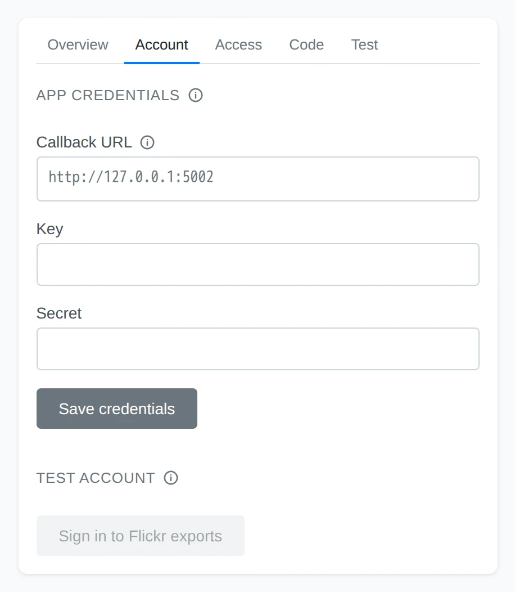
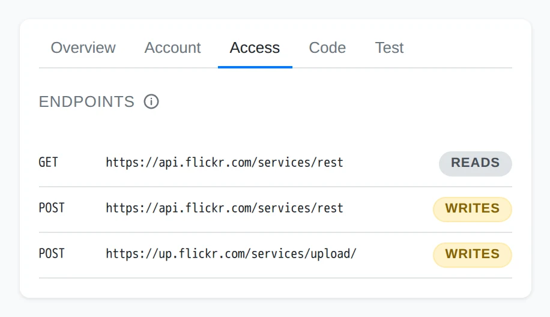
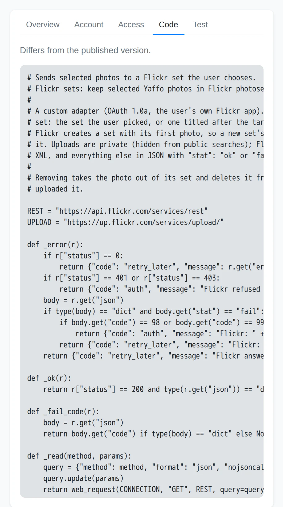
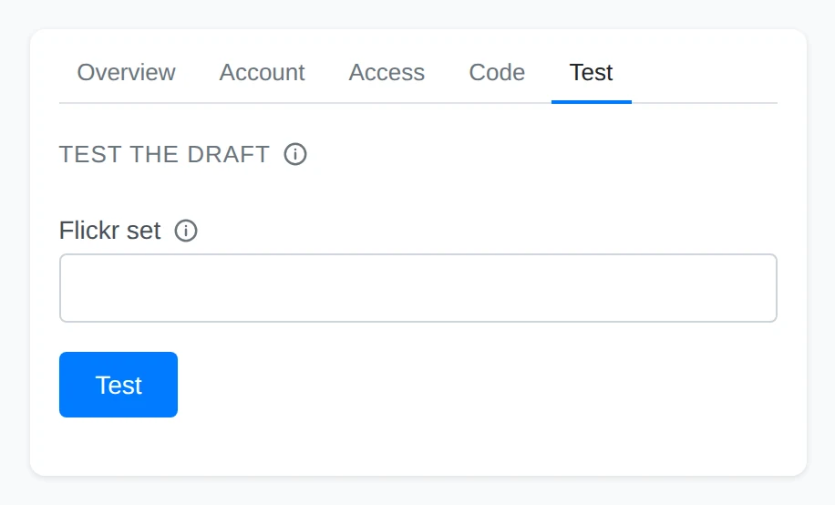
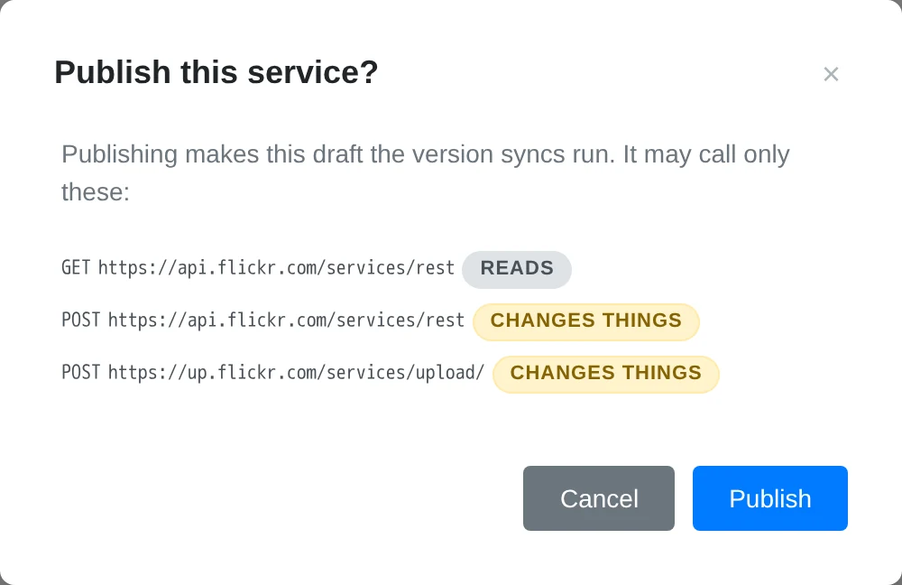
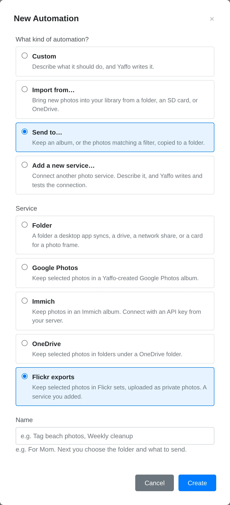

# Creating a Photo Service

A **service** is a reusable connection to a photo service: Yaffo knows how to talk
to it, and every sync that uses it shares that knowledge. Build one when the
service you want is missing from **Import from…** or **Send to…**.

A service and a sync are different things. The service says how photos travel —
which endpoints, which sign-in, which options. A sync says *which* photos travel
and when it runs, and it records its own history. You publish the service once,
then create as many syncs from it as you like.

This walkthrough sends selected photos to Flickr sets as its example. You can
describe another service, or an import instead — the steps are the same, only the
direction you ask for differs. Flickr is not the point: the builder writes code
either way, and the tabs you inspect are the same five.

## Before You Start

Save a model and its provider key in
[Settings → AI Generation](../reference-maintenance/settings.md#ai-generation).
The builder writes the connection from your description, and it uses that model to
do it.

Without a key the chat stores nothing: the message is refused, and a notification
reads **No API key configured. Add your Anthropic API key in Settings → AI
Generation.** (the provider named is whichever model is active). Nothing is lost
— add the key and send the same message again.

## Build the Service

### Choose Add a New Service

Open **Library** → **Automations** and click **New automation**. The dialog asks
what kind of automation you want; choose **Add a new service…**. It is the choice
that builds a reusable connection rather than a sync. Give it the name you will
recognise later, such as **Flickr exports**, and click **Create**.

### Describe the Connection

The builder opens on a draft. Say which service it is and which way photos
travel — for this example: *Send selected photos to Flickr sets. Let me choose a
destination set.* Include the options you need, such as choosing a set or keeping
captions.

The page has two halves. The left is the conversation: every message, the
builder's replies, and any request it needs you to answer, drawn as a card. The
right is five tabs over the draft. The header says **Draft** until you publish,
so nothing here is used by a sync yet; a service you already published says
**Published** even while a newer draft is open.

### Check the Overview

The **Overview** tab summarizes the draft: **Name**, **Direction** (**Imports
photos** or **Sends photos**), **Sign-in**, **Hosts**, the **Options** it offers,
and **Used by**, the number of syncs on the service. A send service also lists
what it **Can** do — **Add**, **Remove**, **Captions**, **Recover** — and its
**Batch size**.

Read the direction first. If it is wrong, say so in the chat rather than building
on it: everything after this — endpoints, test, publish — assumes it.

### Add App Credentials and a Test Account

The **Account** tab appears once the builder knows how the service signs in, and
holds the two things a connection needs.

**App credentials** appears when the service wants to know which application is
asking. Register an app with the photo service, and paste the return address the
tab shows — here **Callback URL** — into the app's own configuration; it is the
address the service sends the browser back to after sign-in. Then save the client
ID and secret the app gives you (the service's own words for them, such as
**Key** and **Secret**) with **Save credentials**. These identify Yaffo's app,
not you, and every sync using this service reuses them; saving different ones
later signs those syncs out. They live in your system keychain, not in Yaffo's
database, and they are never sent to the AI model.

**Test account** is the account the builder's tests read from. For a service with
its own sign-in page the button stays disabled until the app credentials are
saved, then signs you in; for a service that takes a key or a password, fill in
the address (for a server of your own), the username and app password, or the API
key, then click **Connect**. The account is stored like any other sign-in, so a
sync you set up with this service later finds it already signed in. Change it
with **Sign in again**.

If the builder asked to make live read-only calls while you were talking to it
and you allowed it, a **Live reads allowed** chip appears here with **Revoke**.
Revoking stops the builder reading the account on its own; the responses it
already read went to the AI model. **Test** is unaffected — you can always run a
test yourself.

### Read the Access List

The **Access** tab lists every web call the static check found in the draft, each
with its method, its URL, and whether it **Reads** or **Writes**. Nothing outside
this list can be called, and this is exactly the list **Publish** grants.

Read it before you publish. A send service needs writes, but only the ones it
actually uses: a call you do not recognize here will be granted, so delete it
from the conversation before publishing rather than after.

### Inspect the Code

The **Code** tab is the draft itself. You do not have to read it, but it answers
questions the summary cannot, and after the first publish a line above it reads
**Differs from the published version** whenever the draft has moved on — that is
the comparison that tells you a publish is pending.

### Test the Draft

The **Test** tab runs the draft once against the test account. Fill in any options
first, then click **Test**. Reads are live: the service's real answers come back,
which is what makes the test worth running. Writes are recorded and never sent —
the test does not upload, change, or delete anything.

For an option that names something at the far end, such as a set or an album,
leave the field empty for the first run to list the choices the account has, then
test again with one id from the results.

Read the result, then describe any problem to the builder in the conversation.
The builder sees the result with your next message, so you do not need to retype
it. Repeat until the draft behaves as you expect.

### Publish

**Publish** appears in the header once the draft passes its check and differs
from what is published. It opens a review headed **Publish this service?** that
lists the endpoints publication will grant, each marked **reads** or **changes
things**.

Approve it to make the draft the version syncs run.

### Create a Sync With It

Go back to **New automation**. A published send service is now listed under
**Send to…**, and a published import service under **Import from…**, beside the
services that ship with Yaffo.

Choose it and complete the account, photo selection, options and setup review
described in [Automations](automations.md). Publishing the service alone copies
nothing: the service is the connection, and the sync you create from it is what
moves photos.

## While the Builder Works

While it works the builder may ask to read documentation on a domain it has not
seen before. The request appears in the conversation as a card listing the
domains; allow the ones you trust, or deny the request and describe the service
from what you already know. A denied domain is not asked about again. It may also
ask to make live read-only calls to the test account — allowing that lets it check
its own guesses against real answers while it writes; see **Revoke** under
[Add App Credentials and a Test Account](#add-app-credentials-and-a-test-account).

## Draft and Published

A service keeps two versions side by side. The **published** version is what
syncs run. The **draft** is what you and the builder are editing. Existing syncs
keep running the published version while you work on the draft, which is why a
draft can be in pieces, or fail its check, without breaking them.

The tabs inspect the draft. Each is a separate page load, so reload or click the
tab again after the builder answers to see the new state.

A service stays in the **Services** section of the Automations panel, drafts
included, with a **Draft** chip until it is published. Select it there to carry on
editing.

## Update or Remove the Service

**Regenerate** appears in the header when a published service no longer passes
the current version's checks — after an app upgrade, usually — and the page says
so above the tabs. It asks the builder to rebuild the service, keeping what it
does and its direction, and to fix the problems listed. Syncs using the service
are paused until it passes again.

**Delete** removes the service and its stored app credentials. It is unavailable
while a sync still uses the service: delete that sync first, then delete the
service.

## When Something Does Not Work

### The Chat Will Not Send

A notification naming a provider means no key is saved for the active model. Add
it in [Settings → AI Generation](../reference-maintenance/settings.md#ai-generation)
and send the message again — nothing was stored, so the draft is where you left
it. A message that says the builder is already working means a run is still open:
wait for it, or cancel it from the conversation, then send again.

### There Is No Publish Button

**Publish** appears only when the draft passes its static check and differs from
what is published. A warning above the tabs lists what failed; the draft was
still saved, so describe the problem in the chat and let the builder fix it in
place. On a service you have already published, a draft that changes the
direction is refused — syncs depend on it — so keep the direction and change
only the calls and options.

### Delete Is Unavailable

**Delete** is greyed out while a sync uses the service, and the page says so if
you get past it: **A sync still uses this service. Delete that sync first.**
Delete the sync under **Syncs** in the Automations panel, then delete the service.
To keep the service but stop using it, disable the sync instead.

