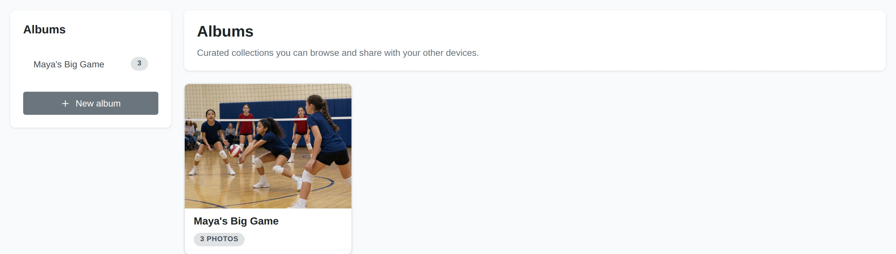
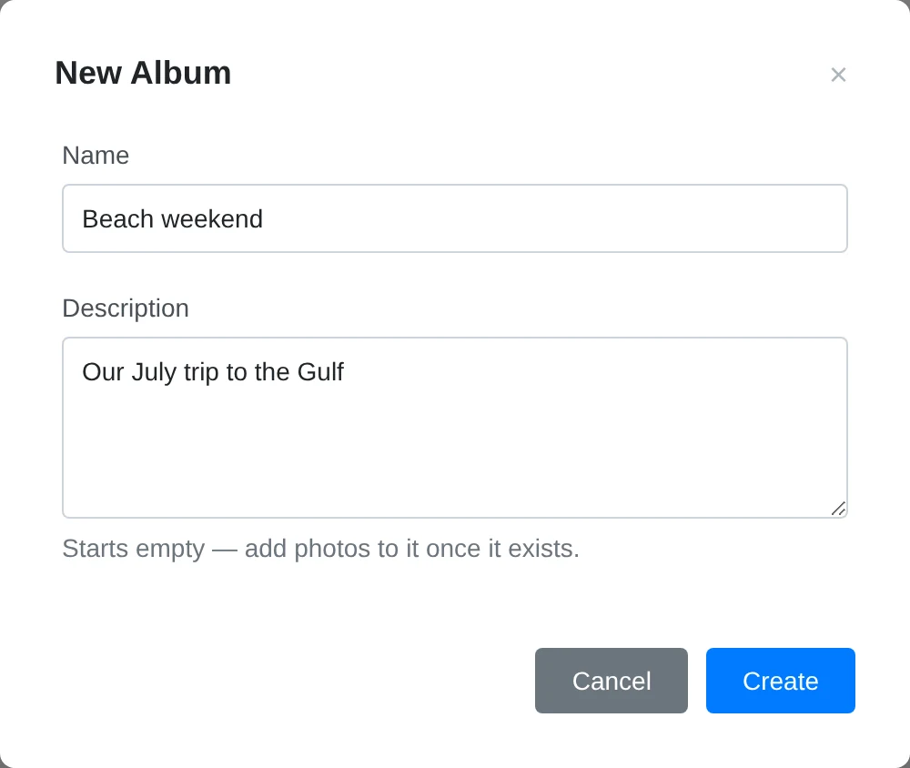
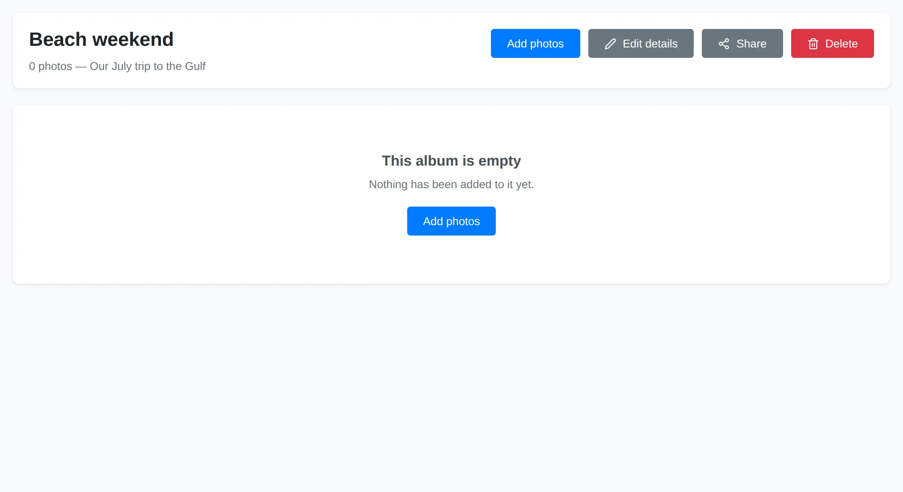
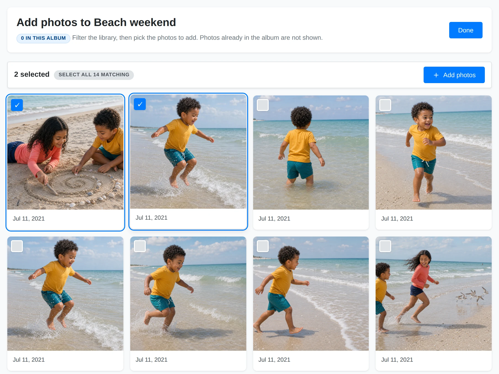
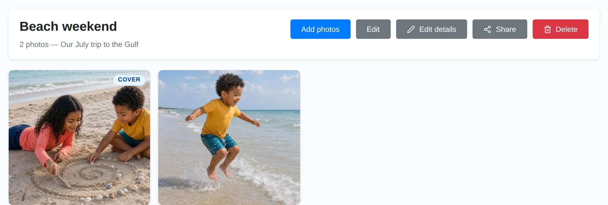
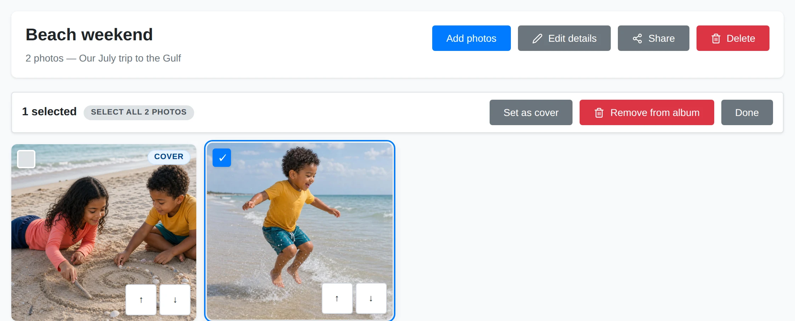
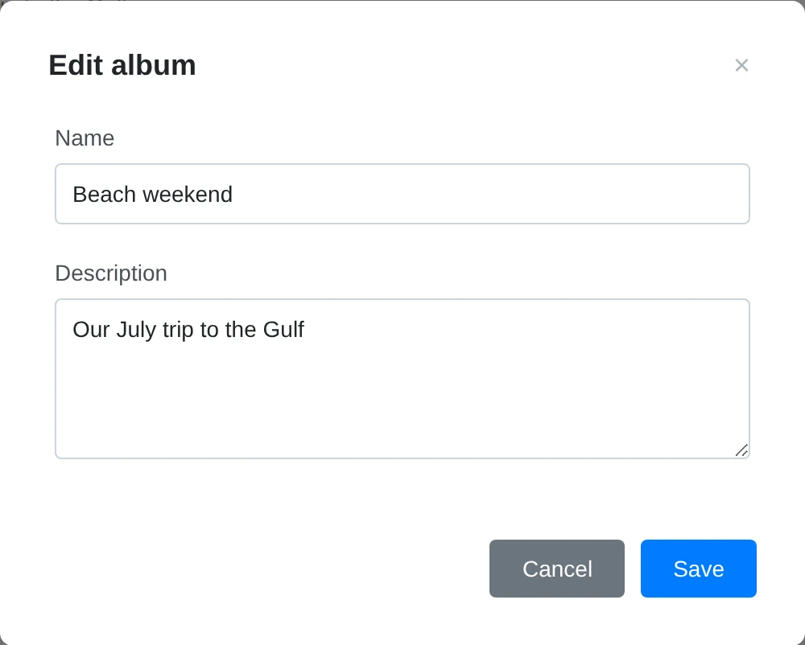
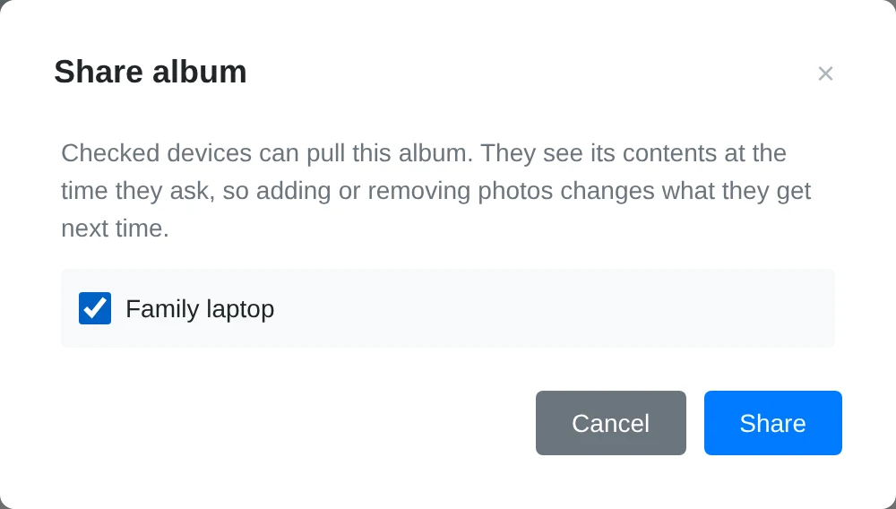

# Albums

An album is a collection you curate by hand. Add a photo once and it stays in
that album until you remove it; changing a filter does not change membership.
The same photo can belong to several albums. Albums can include videos too.

Open **Albums** from the main menu. Creating an album, changing its order, and
deleting it never moves or deletes the original media files.

## Find an Album

### Album List

Choose an album in the sidebar, or use **New album**. On a narrow screen,
open the **Albums** panel from the navigation bar.

### Album Tiles

Each tile shows the cover, name, and member count. **Shared** marks an album
that has been shared with a paired device. Click a tile to open it.

## Create and Fill an Album

This example makes a small album from a beach trip. Choose any photos from
your own library; you can add more later.

### Name the Album

Choose **New album**, enter a name and an optional description, then choose
**Create**. Use a name different from your existing albums.

### Open Add Photos

The new album starts empty. Choose **Add photos** to open your library in
selection mode.

### Pick the Photos

Use the filters to find the trip, then click the photos you want. The selection
bar counts your choices. Choose **Add photos** to add them.

### Return to the Album

Adding keeps you on the selection screen. The confirmation and album count show
what was added, and those photos disappear from the available results. Choose
**Done** to return to your album.

### Add Every Matching Photo

On **Add photos**, apply the filters first, then choose **Select all N
matching**. This selects every match, including photos on other pages. Untick
anything you want to exclude and choose **Add photos**.

Photos already in the album are hidden from this screen and cannot be added
twice. **Nothing left to add** means every photo matching the current filters
is already a member. Change or clear the filters to find more.

See [Browsing, Filtering, and Search](../library-basics/browsing-filtering.md)
for the filter controls.

## Change the Cover, Order, or Members

Open an album and choose **Edit**. Selecting photos in edit mode changes the
selection, rather than opening the photo viewer.

### Member Selection

Choose **Set as cover** with exactly one photo selected. **Remove from album**
removes the selected memberships after confirmation. Choose **Done** to leave
edit mode.

### Album Cover

The **Cover** badge identifies the current cover. Without a pinned cover,
the album uses its first member. Removing the cover does not delete the photo.

### Member Grid

Drag a member to change its position. The order is saved for this album. Where
shown, **Move earlier** and **Move later** provide an alternative to dragging.

Removing a photo from an album leaves it in your library and in any other
albums. This is different from deleting a media file.

## Edit the Name and Description

Choose **Edit details**, change the fields, and choose **Save**. The name must
be present and must not clash with another album's name.

### Album Name

The name appears on the overview tile, in the sidebar, and on the album page.

### Album Description

Use the optional description to explain the occasion or how you chose the
photos. It appears beneath the album heading.

## Share an Album

First [pair your other Yaffo installation](../sharing/pairing-devices.md#pair-two-devices).
Then open an album and choose **Share**.

### Paired Devices

Check the devices that should have access and choose **Share** to save. Uncheck
a device and save to revoke its access to this album. If the list is empty,
pair a device on the Sharing page first.

### Share Access

The receiving device sees the album's current members when it asks. Adding or
removing a member changes future listings; already downloaded copies remain on
the receiving device.

Sharing an album does not grant access to the rest of its photos' folders.
The receiver browses it under **Shared With Me** and chooses which files to
pull. See [Receiving Photos](../sharing/receiving-photos.md) for copying files,
[Sharing Folders and Albums](../sharing/sharing-folders-albums.md) for access,
and [Pairing Devices](../sharing/pairing-devices.md) for device management.

## Delete an Album

Choose **Delete** on the album page and read the confirmation before accepting.
The album and its membership list disappear. The photos and videos themselves
remain in the library.

Use filters for a changing search, an album for a hand-picked collection, or a
[custom page](../create-customize/custom-pages.md) when you want a designed
presentation with widgets.
