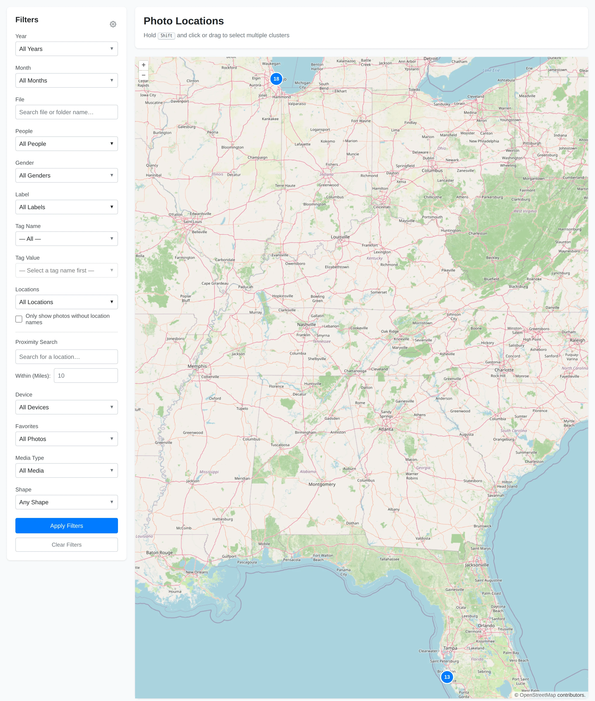
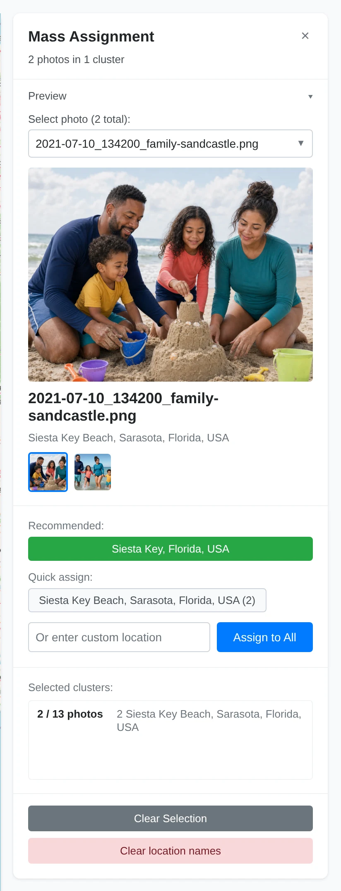

# Locations & Map

The **Locations** page shows photos and videos that have GPS coordinates. It is
useful for reviewing where photos were taken and assigning human-readable
location names.

## Explore the Map

### Filters

Narrow the map by date, people, labels, tags, location names, and more. The gear
chooses which filters the sidebar shows.
[Read about filtering the map](#filter-the-map).

### Selection Hint

Hold **Shift** and click or drag to select several clusters at once.
[Read about selecting photos](#select-photos-on-the-map).

### Zoom

Use **+** and **-**, the mouse wheel, or touch gestures to zoom, and drag the
map to pan.

### Clusters

A numbered marker groups nearby located photos. Click it to select them and open
the selection panel. [Read about markers and clusters](#map-markers-and-clusters).

## Map Markers and Clusters

Each marker represents one or more located media items. When several markers are
close together at the current zoom level, Yaffo groups them into a numbered
cluster. Zooming in can split a cluster into smaller groups or individual
markers.

Use the **+** and **-** controls, the mouse wheel, or normal touch gestures to
zoom. Drag the map to pan.

Photos without GPS coordinates do not appear on the map.

## Select Photos on the Map

Click a marker or cluster to select every photo it represents and open the
selection panel. A plain click starts a new selection. Hold **Shift** while
clicking to add or remove another cluster, or hold **Shift** and drag a box around
several markers.

### Selection Summary

The panel title shows how many photos and clusters are selected. **×** closes the
panel and clears the selection.

### Preview

Shows one selected photo with its file name and location. Switch photos with the
selector or the thumbnail strip, or collapse the section for more room.
[Read about the preview](#preview-the-selection).

### Assign a Name

**Recommended** suggests a name for the selection. **Quick assign** lists the
names already on the selected photos, with counts; click one to give it to every
selected photo. Or type a name and click **Assign to All**.
[Read about assigning names](#assign-location-names) and
[recommendations](#use-recommendations).

### Selected Clusters

Each selected cluster with its photo count and current location names.

### Clear Actions

**Clear Selection** starts over. **Clear location names** removes the assigned
names from the selected photos. [Read about clearing names](#clear-location-names).

Click an empty part of the map, the close button, or **Clear Selection** to start
over.

## Preview the Selection

The **Preview** section shows the currently previewed photo. If the selection has
multiple photos, use the thumbnails or selector to switch the preview.

Collapse the preview section when you want more room for assignment controls.

## Assign Location Names

To assign a custom location name:

1. Select one or more map markers or clusters.
2. Type a name in **Or enter custom location**.
3. Click **Assign to All**.

The selected photos receive that location name, and the map payload updates
without requiring a full page reload.

## Use Recommendations

Yaffo can suggest a location name in two ways:

- If the photos within the configured nearby radius have exactly one saved
  location name, Yaffo recommends that name.
- Otherwise, Yaffo sends the center of the selection to its reverse-geocoding
  service and may suggest the returned place name.

Recommendations are meant to speed up assignment. Review the suggestion before
applying it.

## Clear Location Names

Select one or more photos and click **Clear location names** to remove their
assigned names.

This does not remove GPS coordinates from the original file. It only clears the
human-readable name stored in Yaffo.

## Filter the Map

The Locations page uses the same style of filter sidebar as the gallery. Click
**Apply Filters** to filter the already-loaded map markers in the browser; the
page does not reload or recenter the map.

Useful filters include:

- **Only show photos without location names:** find located photos that still
  need names.
- **Locations:** show photos with specific assigned names.
- **Proximity Search:** find photos near a place.
- **Year**, **Month**, **File**, **People**, **Gender**, **Labels**, **Tags**,
  **Device**, **Favorites**, **Media Type**, and **Shape:** narrow map markers by
  the same library metadata used in the gallery.

Click **Clear Filters** to restore the full located set.

## When the Map Looks Empty

If the map has no markers, follow
[Map or Location Suggestions Do Not Work](../reference-maintenance/troubleshooting.md#map-or-location-suggestions-do-not-work)
in Troubleshooting.

## Ask Yaffo for Location Names

[Ask Yaffo](../start-here/ask-yaffo.md) can suggest location names for photos
from photos already named nearby, and set names or GPS coordinates for a group of
photos, as a change you approve: for example "these camera photos were in Paris,
like the phone photos from that day". It never looks place names up online.
