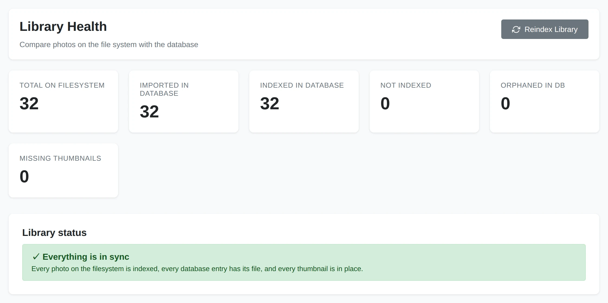
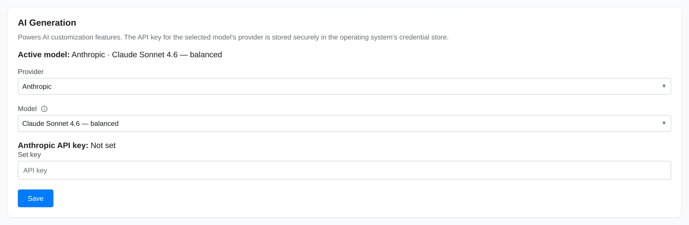

# Troubleshooting

Choose the problem you're seeing and follow its checks. Most problems come down
to indexing or background jobs.

!!! tip "Let Ask Yaffo check for you"
    [Ask Yaffo](../start-here/ask-yaffo.md) can run these checks: describe the
    problem, or click **Ask Yaffo** on the error message or failed job. It reads
    the logs, jobs, and media folders, explains what it found, and proposes a fix
    you can approve.

## What's Going Wrong?

### Photos Do Not Appear

#### Reindex Library

Rebuilds every indexed item, including detected faces. It removes face assignments, so Yaffo asks first.

#### Library Counts

Files on disk, imported and indexed items, items not yet indexed, orphaned entries, and missing thumbnails.

#### Library Status

One card per problem with its fix, or **Everything is in sync** when nothing needs attention.

Answer each question to find the cause. The quickest checks come first.

#### Do Photos Appear After Clearing Filters?

Open the gallery and choose **Clear Filters**, then look for the photo again.

- [Yes, now I can see them](#reapply-filters-one-at-a-time)
- [No, they are still missing](#is-the-folder-listed-in-media-directories)

#### Is the Folder Listed in Media Directories?

Open **Settings** and look under **Media Directories** for the folder that holds
the photos, or a folder that contains it.

- [Yes, it is listed](#can-you-open-the-original-files)
- [No, it is not listed](#add-the-folder)

#### Can You Open the Original Files?

Outside Yaffo, open that folder in Finder or File Explorer.

- [Yes, the photos are there](#are-photos-waiting-to-be-indexed)
- [No, the folder is missing, unavailable, or empty](#reconnect-the-drive)

#### Are Photos Waiting to Be Indexed?

Open **Library** → **Library Health** and look for the **Photos aren't indexed**
card.

- [Yes, the card is there](#index-the-waiting-files)
- [No, there is no such card](#check-file-support-and-indexing-errors)

**Reapply Filters One at a Time**
{: #reapply-filters-one-at-a-time .navigator-outcome }

One of your filters is hiding the photos. Add them back one at a time. Check
whether the filter matches *any* or *all* of your choices, and whether the
people, labels, tags, and locations you selected are actually assigned to those
photos.

See [Browsing, Filtering, and Search](../library-basics/browsing-filtering.md).

**Add the Folder**
{: #add-the-folder .navigator-outcome }

Yaffo only scans folders listed under **Media Directories**. Add the folder,
then index the new files.

See [Add Media Folders](../library-basics/indexing-library.md#add-media-folders).

**Reconnect the Drive**
{: #reconnect-the-drive .navigator-outcome }

Check the cable, power, mount point, and folder permissions. A folder can still
exist, empty, when its drive is not mounted. Make sure you can open the original
photos, then scan Library Health again.

!!! warning "Don't select Remove them while the drive is unavailable"
    **Remove them** deletes the library entries and their faces. Reconnect the
    drive and check the originals first.

Follow [External Drive Not Showing](#external-drive-not-showing).

**Index the Waiting Files**
{: #index-the-waiting-files .navigator-outcome }

Select **Index them** on the **Photos aren't indexed** card, then watch the
background job for progress or errors.

See [Index the New Files](../library-basics/indexing-library.md#index-the-new-files)
and [Watch Background Jobs](../library-basics/indexing-library.md#watch-background-jobs).
If the job never finishes, see [Jobs Are Stuck or Slow](#jobs-are-stuck-or-slow).

**Check File Support and Indexing Errors**
{: #check-file-support-and-indexing-errors .navigator-outcome }

- Make sure indexing has finished. A large library can take a while.
- Confirm the file type is supported. Yaffo skips unusual files and anything
  that isn't media.
- On Library Health, select **Show files** on the card for files that couldn't
  be indexed to see the reason for each one.
- Make sure Yaffo has permission to read the files.

See [Supported Media](../library-basics/indexing-library.md#supported-media)
and [Files That Couldn't Be Indexed](../library-basics/indexing-library.md#files-that-couldnt-be-indexed).
If you're still stuck, [Ask Yaffo](../start-here/ask-yaffo.md) to investigate.

### External Drive Not Showing

If a media directory lives on an external drive, Yaffo can only index it while
the drive is connected, mounted at the expected path, and readable.

1. Check that the drive is visible in your operating system and that you can open
   the folder containing the original photos. A mount point that exists but is
   empty does not mean the library is available.
2. In **Settings** → **Media Directories**, confirm that the configured path still
   points to that folder. Remount or reconnect the drive before changing the
   library configuration.
3. If the folder responds slowly or file listings fail, check the cable, power,
   and drive health before starting another scan. Keep a backup of the originals.
4. Once the files are visible again, use **Library** → **Library Health** to compare
   the filesystem and database. Only select **Remove them** on the
   **Library entries have no file** card after the expected files appear in the
   scan.

An unattended File sync run leaves indexed items under an unexpectedly empty
media folder alone, and Library Health warns about that folder above its cards.
**Remove them** does drop missing items from Yaffo's index, so verify the drive
before you select it. Removing an item from the index does not
repair or reconnect the drive.

If **Ask Yaffo** is available, ask it to check media-folder availability. Its
diagnostic result can distinguish a missing folder, an empty mount point, a slow
listing, and a permissions problem.

See [Indexing & Library Management](../library-basics/indexing-library.md) and
[Settings Reference](settings.md#media-directories).

### Photos Show the Wrong Year

Yaffo places photos in date views using their indexed capture date. A camera clock
set incorrectly, missing capture metadata, or an old index can put a photo in the
wrong year or leave it out of date views.

1. Open an affected photo and check its **Date Taken** on the detail page. Check a
   few photos from the same camera or import to see whether this is one file or a
   whole batch.
2. If the date in Yaffo is correct, check the active year and date filters in
   the gallery. Clear them and look for the photo again.
3. If the original file has the correct capture date but Yaffo shows an old value,
   re-index the affected media. **Reindex Library** rebuilds detected faces and
   removes their person assignments, so review its confirmation before using it
   for the whole library.
4. If the original file's date is wrong or absent, correct the source metadata
   first, then re-index. If **Ask Yaffo** is available, you can instead ask it to
   find the affected items and propose a capture-date correction in Yaffo. Review
   the listed count and dates on its change card before approving.

The assistant's health report can identify impossible dates (before 1900 or in
the future) and a large share of undated items. These are clues to inspect, not
proof that every flagged date is wrong.

See [Indexing & Library Management](../library-basics/indexing-library.md#re-index-after-changes).

### Jobs Are Stuck or Slow

Indexing, classification, and face detection run as background jobs.

- **Give large libraries time.** A first index of a big library processes every
  file and can take a while. Progress is shown as it works.
- **Make sure the background worker is running.** Yaffo processes jobs with a
  background task host. If jobs never start or never finish, the host may not be
  running — restart the application.
- **Cancel and retry.** You can cancel a job that seems stuck and start it again.

### Faces Stuck After Assigning

If assigned faces keep appearing in the review pile, or face processing never
finishes, start by checking the job and face status. These symptoms can have
different causes.

1. Open **Faces** and refresh the page. Check whether the faces are still
   unassigned or whether the same person has already been linked to them.
2. Check the related indexing or face job for progress and errors. If a job never
   starts, restart Yaffo so its background task host can resume queued work.
3. If the job has finished but faces remain stuck, use **Ask Yaffo** to run a
   health check. It can identify faces linked to a person but still marked
   unassigned, or faces left in **PROCESSING** with no queued face task.
4. When the assistant proposes a **Repair faces** change, review the affected
   count and approve its card. The repair corrects inconsistent face statuses;
   it does not choose a person for an unassigned face.

For ordinary unassigned faces, continue with the [Assigning Faces](../organize-review/assigning-faces.md)
workflow. If automatic assignment is enabled, review its threshold and recent
runs under **Library** → **Automations** → **Auto-assign faces**.

### Faces, Labels, or Duplicates Look Wrong

Machine learning powers these features, so they are helpful but not perfect.
Some mistakes are expected, and you can correct each one:

- **Wrong or missing faces.** Review unassigned faces, fix wrong assignments
  from a person's page, and ignore low-quality faces. See
  [Assigning Faces](../organize-review/assigning-faces.md). If face processing
  never finishes or assigned faces come back, see
  [Faces Stuck After Assigning](#faces-stuck-after-assigning).
- **Wrong or missing labels.** Treat labels as search hints. Adjust the label
  vocabulary and re-classify if needed. See
  [Labels and Auto-Classification](../organize-review/labels.md).
- **Duplicate matches you disagree with.** Always review a duplicate group before
  removing anything. See [Finding Duplicates](../organize-review/duplicates.md).

As your library grows, re-running the relevant step or lowering a similarity
threshold often improves results.

### Map or Location Suggestions Do Not Work

- **Check for GPS metadata.** Only photos with GPS coordinates appear on the map.
  Many scans and screenshots have none. A saved location name alone is not
  enough.
- **Clear map filters.** Active filters on the Locations page hide markers.
  Choose **Clear Filters** to restore the full located set.
- **Check that the photos are indexed.** If they are missing from the library
  too, see [Photos Do Not Appear](#photos-do-not-appear).
- **Fill in missing coordinates.** The **Geotag from neighbors** automation can
  copy GPS from nearby photos taken around the same time.
- **Location names need a lookup.** Names come from nearby photos that already
  have a name, or from an online map lookup that needs a network connection. See
  [Locations & Map](../organize-review/locations.md).

### AI Features Do Not Work

#### Active Model

The provider and model Yaffo will use.

#### Provider

Choose a provider to look up its models and show its key settings.

#### Model

Search the provider's models and select one.

#### API Key

Whether the provider's key is set. Save a key here; it is stored in your operating system's credential store.

The page builder, theme designer, and custom automations need AI generation to be
configured.

- **Set a model and API key.** In **Settings** → **AI Generation**, choose a
  provider, save its API key, then choose a model. **Active model** shows what
  Yaffo will use. The key is stored in your operating system's credential store.
  Without a valid key, generation cannot run.
- **Check your network.** Generation calls the model provider over the internet,
  so it fails when the computer is offline or the connection is blocked.
- **Read the error.** Yaffo shows provider errors such as an invalid key, a rate
  limit, or an unavailable model. The message usually names the cause.

See the [Settings Reference](settings.md) for where these options live.

## Still Stuck?

[Ask Yaffo](../start-here/ask-yaffo.md) to investigate. It can read the logs,
background jobs, and media folders and propose a fix. Start from the error
message or failed job when there is one, so it has that context.
