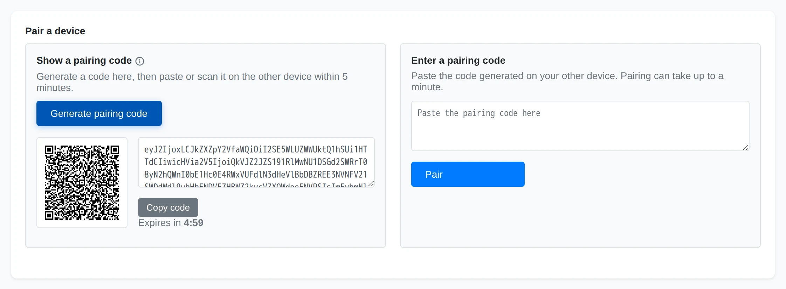
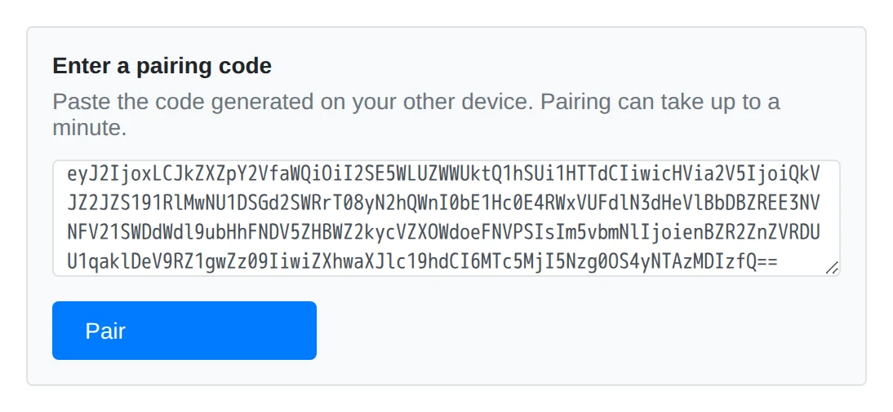
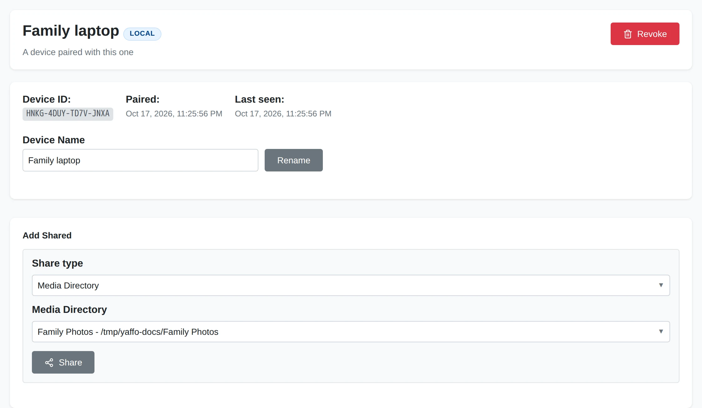

# Pairing Devices

Pairing establishes trust between two Yaffo installations. It does not grant
access to any media by itself. Both installations must be running and reachable.

## Pair Two Devices

Open **Sharing** on both installations. In this example, **Photo library** is
the installation with the photos and **Family laptop** receives them. The
names are labels you can change after pairing.

### Generate a Code on the First Device

Under **Show a pairing code**, choose **Generate pairing code**. Copy the code,
or scan its QR code from the other device. Keep both installations online.
The code expires after five minutes and can be used once.

### Enter It on the Other Device

On the other installation, paste the code under **Enter a pairing code** and
choose **Pair**. Pairing can take up to a minute. If it fails, check that the
first device is still running and generate a fresh code if the old one expired.

### Check the Paired Device

Choose the new device in the sidebar. Confirm its device ID against the other
installation and give it a useful **Device Name** with **Rename**. The label
is local to this installation.

**Local** means the device has been discovered on your local network.
**Online** indicates hub presence. **Offline** indicates that the hub reports it
absent; **Unknown** means presence could not be determined. A disconnected hub
does not prevent local-network pairing and transfers.

Renaming a device changes its label, not its identity or permissions.

## Revoke or Forget a Device

Choose the device and use **Revoke**, then confirm. It loses access to everything
this installation shared with it. Previously downloaded files remain on it.
Pair again if you want to restore trust; review the sharing grants afterwards.

After revocation, **Delete** removes the device entry from this installation.
Confirm the action to forget it. To share with that device again later, pair it
again and choose the scopes to grant.

Next, [choose what to share](sharing-folders-albums.md).
