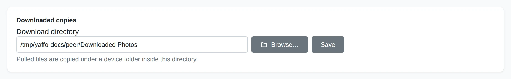
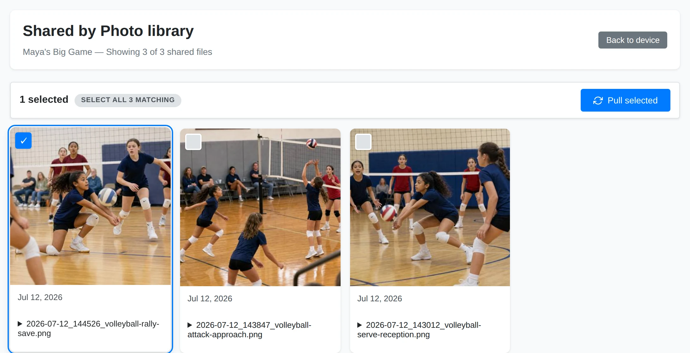
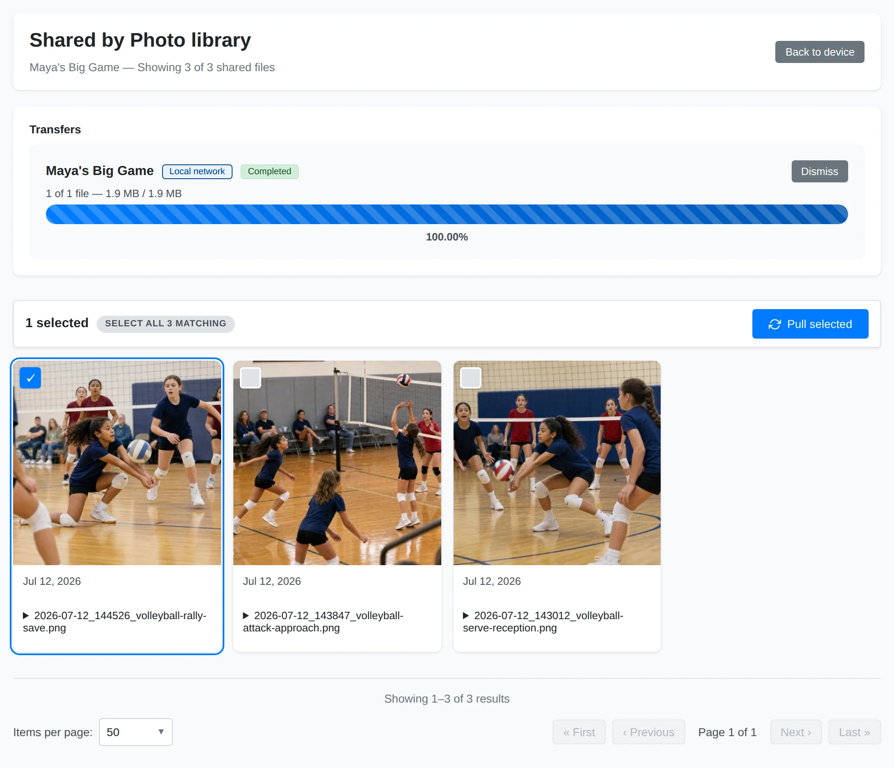
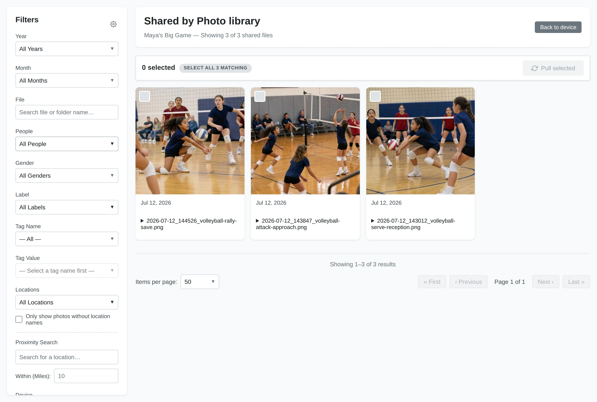

# Receiving Photos

First [pair the devices](pairing-devices.md) and have the sender
[grant access](sharing-folders-albums.md). Receiving makes local copies; it does
not move or delete the sender's originals.

## Pull Copies to the Other Device

On the receiving installation, set a download directory before selecting files.
Then open a share from **Shared With Me**.

### Choose Where Copies Go

Open **Sharing** and set **Download directory** under **Downloaded copies**.
Use **Browse…** or enter a local folder, then choose **Save**. Copies are stored
under a device folder inside this directory.

### Select the Shared Photos

Choose **View** beside the shared folder or album. Click the photos you want,
or choose **Select all N matching**. That selects all matches across pages;
untick any exceptions. Choose **Pull selected** to start.

### Check the Transfer

The pull runs in the background. The **Transfers** panel shows its state,
progress, and connection path. Wait for **Completed** before relying on the copy.
You can leave the gallery and return to the device page to check progress.

Without a saved download directory, the gallery displays a notice and a
**Set download directory** link instead of selection controls.

## Find and Index the Copies

Open the saved download directory in your computer's file manager. Inside it,
look for the sending device's name, then the shared folder or album name.
**Completed** means the files have been saved there; a manual pull does not
automatically add them to the receiving installation's library.

To browse the copies in Yaffo:

1. Open **Settings** and add the download folder under **Media Directories**.
   If it is already inside a configured media directory, use that existing
   directory.
2. Open **Library** → **Library Health** and select **Index them** on the
   **Photos aren't indexed** card when the new files appear.
3. Wait for indexing to finish, then open **Home** to browse the local copies.

See [Indexing & Library Management](../library-basics/indexing-library.md) for
scan results and indexing progress. To copy and index matching photos
automatically on later runs, use a
[paired-device import sync](../create-customize/importing.md#import-from-a-paired-device)
instead of repeating manual pulls.

## Browse a Remote Gallery

### Remote Filters

Filter the sender's shared files by the available dates, people, labels, tags,
and other library filters. Options come from the shared scope on that device.
Choose **Apply Filters** after changing your choices.

### Remote Selection

The count and **Pull selected** action apply to your current selection. With
**Select all N matching**, the scope includes matching files on other pages.

### Remote Photos

Previews come from the other device. Browsing does not download originals into
your chosen folder; pulling does. A preview can take a moment to load.

If the device cannot be reached, make sure it is running, check the connection,
and try again. If no files appear, check the filters and ask the sender to
confirm the grant and that its media directory is available.

Pulling is a copy operation, not a continuing synchronization. Later changes at
the sender do not automatically update the copies you already pulled. For
scheduled imports from a paired device, see
[Importing Photos](../create-customize/importing.md).

See [Transfers and Connections](transfers-connections.md) for progress, failures,
relay limits, and cancellation.
