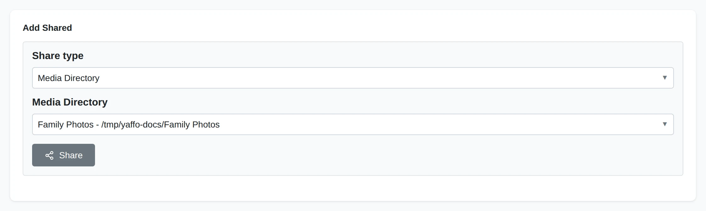
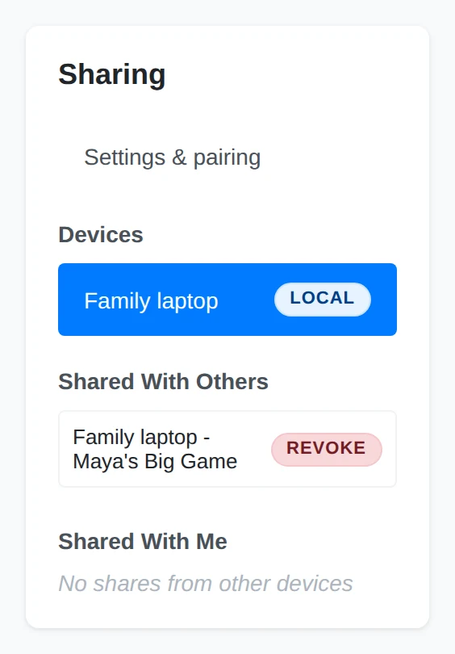

# Sharing Folders and Albums

After [pairing your devices](pairing-devices.md), choose what each one may browse
and copy. A grant exposes only the scope you choose; the receiver decides which
files to pull. Sharing never moves or deletes the sender's originals.

## Choose What to Share

On the installation with the photos, choose the paired device in the sidebar.
Under **Add Shared**, choose the scope, then choose **Share**.

### Share Type

Choose **Media Directory**, **Folder**, or **Album**. Pairing alone grants none
of these scopes.

### Shared Location

For a media directory, select one configured in Settings. For a folder, enter or
browse to a folder inside a configured media directory. For an album, select
one of your albums.

### Grant Access

**Share** grants this device access to the chosen scope. Sharing the same scope
again does not create another copy of the grant.

A media-directory share covers its library tree. A folder share limits access to
that folder's subtree. An album share follows the album's current membership,
including members stored in different media directories. It does not expose the
rest of those directories. You can also use an album's **Share** dialog; see
[Albums](../organize-review/albums.md#share-an-album).

### Review or Revoke a Share

#### Outbound Shares

**Shared With Others** lists the scopes this installation exposes. Choose the
row's **Revoke** action and confirm to stop sharing that scope with that device.

#### Incoming Shares

**Shared With Me** lists scopes offered by your paired devices. Choose **View**
to browse one. Pairing without a grant leaves this list empty.

Revoking a share keeps the pairing and any other grants. It does not remove
files already copied to the receiving device.

See [Receiving Photos](receiving-photos.md) for the steps on the other device.
