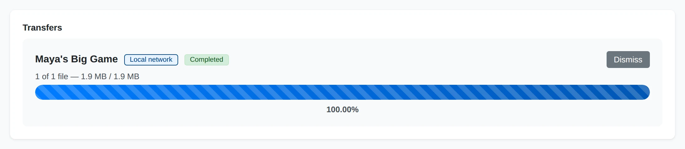

# Transfers and Connections

After [starting a pull](receiving-photos.md), follow its progress in the
**Transfers** panel on the remote gallery or paired device page.

### Transfer State

The badge shows whether the batch is collecting its file list, transferring,
paused, completed, cancelled, or failed. The path badge identifies the connection.

### Transfer Progress

Counts show files processed and bytes transferred. When present, the relay count
shows how much data passed through the metered relay.

### Transfer Actions

Cancel active work, or dismiss an inactive record. These actions keep copies
already completed.

## Connections and Relay Limits

Yaffo uses a local-network or direct connection when available. If a direct
connection cannot be established, it can transfer through a relay. The transfer
badge identifies **Local network**, **Direct**, or **Via relay (metered)**.

A relayed batch pauses when it reaches the soft relay-data budget. This is a
pause, rather than a failure. Put both devices on the same network when
possible, or choose **Continue anyway** to allow the batch to keep using the
metered relay. Choose **Cancel** if you do not want it to continue.

## Manage Transfers

- **Cancel** stops an active transfer. Copies already completed are kept.
- **Completed with errors** means some files failed. Review the file errors and
  check that the sender and its files remain available.
- **Dismiss** removes an inactive transfer record from the panel. It does not
  delete the downloaded files.

## If a Transfer Does Not Finish

Check that both Yaffo installations are running, that the sender's media folder
is available, and that the receiver's download directory can be written to.
For a paused relay batch, review the budget message before continuing. For a
failed batch, correct the reported problem, then return to the shared gallery
and start a new pull of the files you still need.
