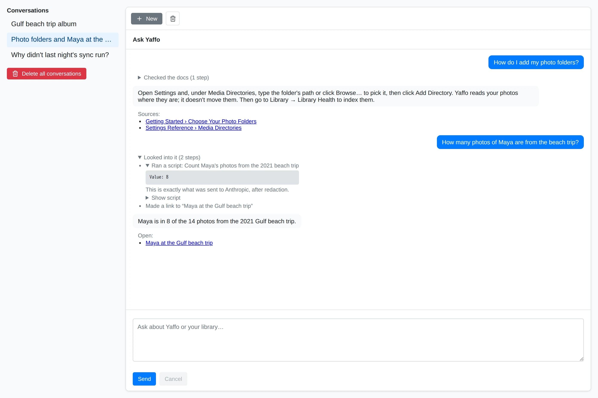
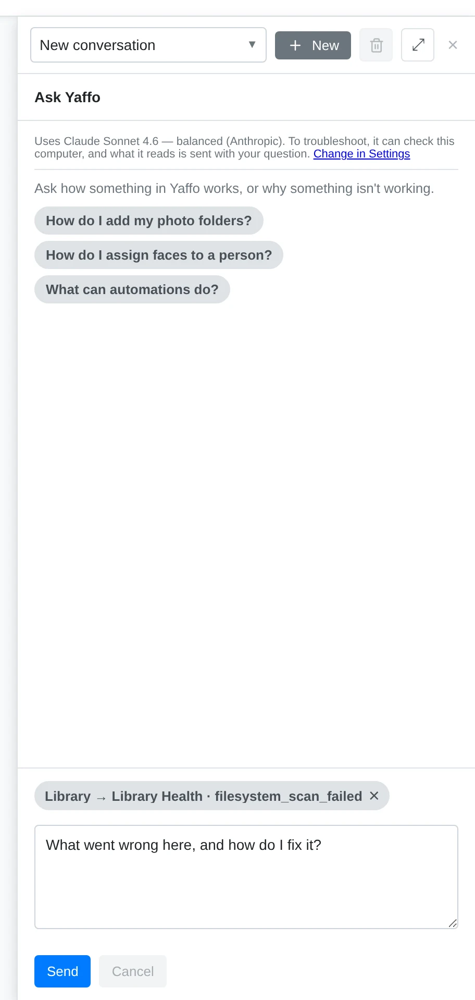
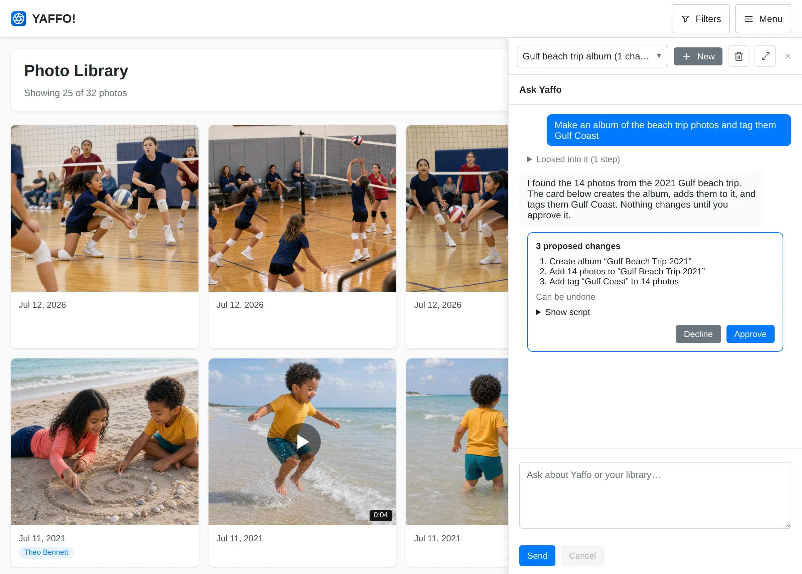
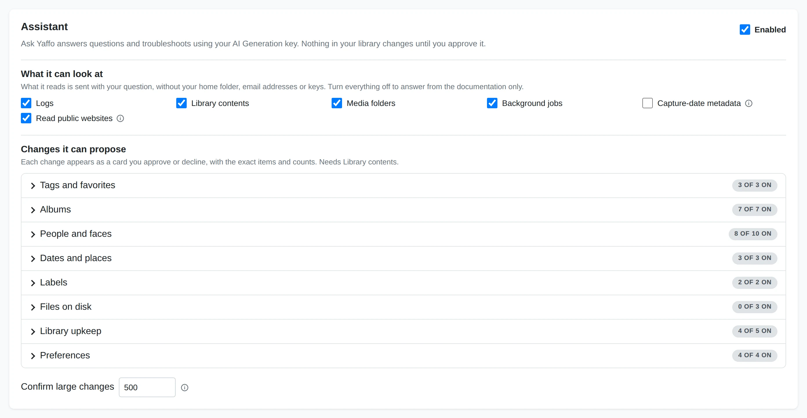

# Ask Yaffo

**Ask Yaffo** is Yaffo's built-in assistant. Ask it how something works, why
something isn't working, or to make a change to your library, such as "tag every
photo from the Yellowstone trip". It answers from Yaffo's own documentation and,
when you allow it, from the state of this computer. It never changes anything
until you approve the change.

Ask Yaffo uses the model and API key you set up under **Settings** →
**AI Generation**, the same as the page builder and theme designer. This feature is hidden if no key is configured.

## Open Ask Yaffo

Click the round **Ask Yaffo** button in the bottom-right corner of any page. On a
smaller screen, open **Menu** and choose **Ask Yaffo** instead. The assistant opens
in a panel over the page you're on, so you can keep working while it answers.

- **New conversation** starts over with no earlier context.
- **Open full page** shows the assistant on its own page, with your
  **Conversations** listed beside it. Conversations are kept until you delete them.
- Drag the panel's edge to resize it; double-click the edge to reset it.

### Conversation List

Earlier conversations, kept until you delete them. **Delete all conversations** removes every one.

### New and Delete

**New** starts a conversation with no earlier context. The bin deletes the current conversation.

### Sources

The guide pages a how-to answer used.

### Activity

Each check or script appears as a line under the answer. Expand it to see what was sent to the AI provider, and **Show script** to see exactly what ran. [Read about questions](#ask-questions).

### Open Links

Links into the app, such as a gallery filtered to the photos the answer found. Nothing opens until you click.

### Message Box

Type your question and click **Send**. **Cancel** stops an answer; what it already wrote stays.

### Ask About a Problem Where It Happens

Many error messages, failed job cards, and run history rows with errors have
their own **Ask Yaffo** button. It opens a new conversation with what went wrong
attached, shown as a chip above your message, and suggests a first question:
"What went wrong here, and how do I fix it?" Edit the question if you like, or
remove the chip with its ✕, then send it.

#### Panel Toolbar

Switch conversations, start a **New** one, delete this one, open the full page, or close the panel.

#### Model Notice

The model Ask Yaffo uses, from **Settings** → **AI Generation**, with a link to change what it may check.

#### Attached Context

What went wrong, attached from the error you started from. Remove it with its **✕**.

#### Suggested Question

Yaffo fills in a first question. Edit it if you like, then click **Send**.

When the attached context names a job or an automation, and the assistant may
look at background jobs, Yaffo looks up that job or the automation's recent runs
before the assistant starts. You'll see this as the first line of its activity.

## Ask Questions

Ask the way you'd ask a person: "How do I add my photo folders?", "What do
automations do?", "How many photos of Billy do I have from 2019?"

- **How-to questions** are answered from Yaffo's user guide. The pages it used
  are listed under the answer as **Sources**.
- **Questions about your library** are answered by looking it up. The assistant
  writes a short script that reads your library and shows it as an activity line,
  such as "Ran a script: Count photos of Billy by year". Click **Show script** to
  see exactly what ran. A script can read your library and propose changes as
  approval cards; the changes are applied only after you approve them.
- **Links.** When an answer points somewhere in the app, the assistant adds links
  under it (**Open:**), such as a gallery already filtered to the photos it found.
  For a file or folder on your computer it adds a button: **Open on this computer**
  or **Show in its folder**. Nothing opens until you click.

While it's answering, you can stop it. What it already wrote stays in the
conversation.

### Read a Web Page

Include a public page's HTTPS URL in your question to let Ask Yaffo read it.
**Read public websites** is enabled by default under **Settings** → **Assistant**
→ **What it can look at**. Turn it off there to disable web reads.

Before reading a new website, the assistant shows an approval card with its
domain and the pages it wants to read. Choose the domains to allow and click
**Allow selected**, or click **Deny**. Your decision applies only to that
conversation, and the assistant continues when you decide. A link in your message
does not grant access by itself.

Page contents are sent to your AI provider, and successful reads appear under
**Sources**. Expand the activity line to see the text the assistant received.
This reads pages at known URLs; it does not run search-engine queries.

Allowed domains can be read again in the same conversation. A new conversation
starts with no website approvals, and denying a domain stops reads from it in
that conversation. Turning **Read public websites** off removes the web tool
from future turns and stops earlier web results from being sent again.

## Troubleshoot Problems

Describe what's wrong: "My external drive isn't showing", "Faces are stuck after
assigning", "Why did last night's sync fail?" The assistant checks before it
answers. It can:

- run Yaffo's health checks;
- read recent errors from Yaffo's logs;
- check your media folders and whether a drive responds;
- look at background jobs, the task host, and automation runs and settings;
- check device sharing and recent transfers;
- look up everything about one photo.

Each check appears as an activity line under the answer. Expand a line to see
exactly what was sent to the AI provider.

The [Troubleshooting](../reference-maintenance/troubleshooting.md) pages describe
common problems and what the assistant looks for.

## Make Changes With Approval

Ask for a change in plain words. The assistant finds the items, then proposes
the change as a card under its reply. The card is written by Yaffo, not by the
AI, and shows:

- each step, with the number of photos, faces, or other items it affects;
- whether it can be undone.

Click **Approve** to apply it or **Decline** to drop it. Nothing changes before
you approve.

### Proposed Steps

Each step with the number of items it affects. Yaffo writes this card, not the AI.

### Undo Status

Whether the change can be undone. [Read about undo](#undo-a-change).

### Show Script

The script that found the items and proposed the change.

### Approve or Decline

**Approve** applies exactly the items on the card. **Decline** drops it. Nothing changes before you approve.

- **Large changes.** Above a set number of items (500 by default), check
  "Yes, change all N items" before **Approve** is available.
- **Changes to files on disk** (renaming, moving, or moving photos to the system
  trash) are off until you turn them on in Settings. When they're on, type the
  number of items to confirm.
- **Expiry.** A card that isn't approved within 30 minutes, or whose items
  changed in the meantime, expires. Ask again to get a fresh one.

Approving applies exactly the items on the card, even if your library changed
after the card appeared.

### Undo a Change

After a change runs, most cards keep an **Undo** button. Undo restores what the
change replaced. Items that changed again since, by you or an automation, are
left as they are. A card marked **Can't be undone** has no Undo: for example
moving photos to the system trash (restore them from the trash instead),
deleting an album or a person, or cancelling a job.

### What It Can Change

What the assistant may propose is set in **Settings** → **Assistant**. By
default it can:

- **Tags and favorites** — add or remove tags, mark favorites.
- **Albums** — create, rename, and delete albums, add or remove photos, choose
  the cover, and put photos in order.
- **People and faces** — create and rename people, assign or unassign faces,
  ignore faces you don't want to name, set a birthdate, and repair faces stuck
  in the wrong state. It can also find unassigned faces that look like someone,
  or group unassigned faces that look alike, so you can name them.
- **Dates and places** — change capture dates, location names, and GPS
  coordinates. It can suggest location names from photos already named nearby;
  it never looks places up online.
- **Labels** — add labels to the vocabulary, or remove them. Photos get a new
  label when they're classified again: click **Re-classify all photos** in
  Settings, or let the assistant start it when **Run automation** is on.
- **Library upkeep** — re-index items, cancel a background job, and turn
  automations on or off.
- **Preferences** — change the theme, the language, the distance unit, and which
  filters the sidebar shows.

Off by default, until you turn them on: renaming or moving files, moving photos to
the system trash, merging or deleting people, and running an automation.

**Duplicates.** The assistant can read the results of a duplicate scan, suggest
which copy in each group to keep, and propose moving the others to the system
trash or into a folder for review. Start the scan from **Library** →
**Remove Duplicates** yourself, or let the assistant start it when **Run automation** is on; moving
files needs those file switches on too. See
[Finding Duplicates](../organize-review/duplicates.md).

**Recurring changes.** For rules that should keep applying, such as "tag every
new photo from this camera", the assistant points you to
[Automations](../create-customize/automations.md) instead.

## What Is Sent to the AI Provider

- **Your messages**, and the results of the checks and scripts the assistant runs:
  log lines, file and folder names, people's names, counts, and settings.
- **Tool results and attached error context** are redacted before sending. Yaffo
  replaces your home folder with `~`, shows media
  folders as labels instead of full paths, rounds GPS coordinates, and hides
  email addresses and anything that looks like a key.
- **Never sent:** your photos and videos themselves, the database, or your API
  keys. Reading capture dates from files is a separate setting, off by default.

The assistant connects to your AI provider and to public websites whose domains
you approve for the conversation. Conversations and the
record of what was sent stay on this computer until you delete them, one
conversation at a time, or all at once with **Delete all conversations** on the
full Ask Yaffo page.

To limit what it can check, turn groups off in
[Settings → Assistant](../reference-maintenance/settings.md#assistant). With
every group and **Read public websites** off, it answers from the bundled
documentation without reading local diagnostics or public web pages.

### Enabled

Shows or hides Ask Yaffo.

### What It Can Look At

What the assistant may check on this computer. Turn everything off and it answers from the documentation only.

### Changes It Can Propose

One group per kind of change, with how many are on. [Read about what it can change](#what-it-can-change).

### Confirm Large Changes

Above this many items, **Approve** also asks you to confirm the count.

## What It Won't Do

- Look at the content of your photos.
- Change your media folders, thumbnail folder, API keys, or device sharing. It can
  explain sharing and check its status, but pairing and sharing stay with you.
- Edit automation, custom page, or theme code. Use the builders for those.
- Delete files permanently. Photos only ever go to the system trash.
