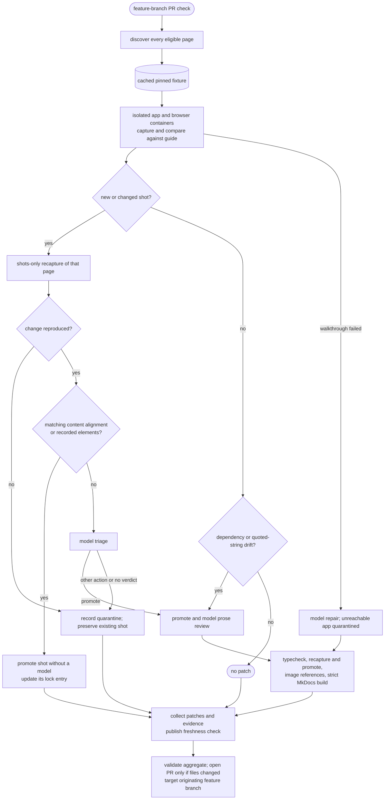

# Documentation Automation

> **Status: running with complete app-backed guide coverage.** The pipeline checks
> screenshots and prose, proposes updates, and reports unresolved changes for human
> review. Current limitations are listed under *Current limitations*.
>
> **Infrastructure** — `yaffo_ui_tests/lib/user_doc_automation/`: capture
> mechanics (settle, framing, WebP encode, pixel comparison), the containerized capture
> worker and its host half, dependency observation, both detectors, the correctness
> gates, the agentic loop (evidence, triage, fix, tool loop, preflight, sandbox facts),
> and six entry points. The server-side observer is `yaffo/doc_observer.py`.
>
> **Content** — `yaffo_ui_tests/user_doc_automation/spec.yaml` declares **25 guide
> pages**. There are **20 walkthroughs and lockfiles covering 52 committed
> screenshots**, including two dependency-only walkthroughs. Sixteen pages also have
> generation catalogs; a catalog is not required for capture or healing discovery.
> All 20 lockfiles carry a watermark and dependency fingerprints.
>
> **Entry points**, all working: `docs:capture` (deterministic capture, `--promote`
> writes into the guide, `--docker` containerizes, `--defer-errors` hands a thrown
> walkthrough to healing); `docs:generate` (writes a page and its walkthrough from the
> page's charter, gated on the two agreeing); `docs:heal` (triage and repair);
> `docs:detect` (dependency fingerprints plus quoted-string changes, no sandbox);
> `docs:validate` (guide and automation agree); `docs:heal:repo` (GitHub fan-out
> matrix). `docs:sandbox:build`, `docs:sandbox:start`, and `docs:sandbox:stop`
> manage the pinned app container and fixture.
>
> **CI** — `.github/workflows/documentation-auto-heal.yml` runs the whole thing on
> feature-branch PRs: discover → cached fixture build → per-page fan-out (capture, heal,
> patch) → one aggregated healing PR against the feature branch.
>
> **Tests** — Jest suites in `lib/user_doc_automation/__tests__/` cover capture,
> detection, routing, and repair. Python tests cover image comparison, review sheets,
> the server observer, and artifact summaries. See *Tests* below.
>
> **Coverage:** five reference pages have `walkthrough: false`: comparison,
> uninstalling, and the three troubleshooting subpages. Every other declared page
> has a walkthrough and lockfile.
>
> Last updated: 2026-10-17

## Goal

Keep the published user guide (`docs/guide/**`, MkDocs Material, deployed by
`.github/workflows/docs.yml`) in step with the app, without a human remembering to
re-shoot screenshots after every UI change.

The documentation checks run against the head commit of a feature branch's PR. When
something has gone stale, the healer creates an auto-generated branch from that exact
commit and opens a second PR containing both regenerated screenshots and updated prose.
The healing PR targets the originating feature branch, not `master`; the automation
never pushes directly to either branch and never auto-merges.

The same entry point runs locally, so a stale shot can be fixed and reviewed
without waiting for CI.

## Scope

**In:** `docs/guide/**` — the 25 user-guide pages, both their **screenshots and
their prose**. Stale images and stale text are regenerated in the same PR rather than
staged as separate rollouts: a renamed control usually invalidates both the shot
showing it and the sentence naming it, so splitting them would produce two changes
that each look wrong in isolation.

**Out:** `docs/development/**`. Architecture prose is where a model most reliably
invents plausible-sounding falsehoods, and those docs change on a different rhythm.
They stay hand-written.

## Two artifacts, two different guarantees

This distinction drives the whole design and is worth stating before the pipeline.

**Screenshots are reproducible captures.** The walkthrough and its screenshot
baselines are committed. Capture pins the container, seeded fixture, and app commit;
comparison tolerates bounded rendering noise, and new or changed shots must reproduce
on an immediate recapture before promotion. When a shot breaks — a renamed selector, a
moved page — the agent repairs **the spec**, and the PR carries both the spec change
and the regenerated image. This mirrors the existing test framework: specs are the
source of truth, execution is deterministic, and healing edits code rather than
output. An agent that emitted images directly would produce artifacts nobody could
reproduce or audit.

**Prose is not deterministic.** No script generates markdown. The agent edits `.md`
files directly, so the same input can yield different wording. What replaces
reproducibility is *boundedness*: the input is limited to one page's dependency
diff, the edit is scoped to one page, and a human reviews the PR before it merges. Do
not blur these two under "the bot updates the script" — they carry different
guarantees, and *What the agent owns* sets out the boundary.

## Pipeline



A full successful gate capture runs with `--promote`, refreshing the page watermark,
dependency fingerprints, and screenshot entries in the same patch as the prose and
images. Mechanical approval instead updates only the promoted shot entry.

CI captures every page that has an enabled walkthrough and a lockfile. The checks in
`docs:heal` use that capture plus dependency hashes and quoted-string changes.
Visual drift requires a capture even when dependency hashes match, so every eligible
page gets a sandbox. The fixture cache reduces setup cost. `docs:detect` provides a
local dependency/string check without a sandbox; CI does not use it to skip pages.

## Local / CI parity

Capture is **containerized**: the official Playwright image, pinned to the
`@playwright/test` version in `package.json`, used identically on a laptop and on the
runner. `npm run docs:capture:docker`.

Both local and CI captures use the pinned Linux environment. Font metrics,
anti-aliasing, and image processing can vary across platforms, so host-native captures
are not suitable baselines for the containerized pipeline. Committed screenshots
are Linux-rendered. Browser confinement and the environment allowlist also apply.

### Where the boundary sits

The capture worker runs the browser in a container and stops at PNG plus `raw.json`;
the host reads these back and does WebP encoding, pixel comparison, and promotion.
The app is served by a separate container using the same pinned docs image.

The seam is forced by tooling: encoding and comparison use Pillow and NumPy from the
project virtualenv, which is not in the Playwright image and should not be added to it.
`runner.ts` splits accordingly — `captureWalkthroughs` (containerizable) and
`processResults` (host) — with `runWalkthroughs` composing both, so a plain
`docs:capture` and a `--docker` one run the same code.

The staged PNG's path is not carried in `raw.json`. It is a pure function of the
staging directory and the shot's target, so each side recomputes it against its own
paths rather than translating a container path back — the file is the same file either
way, reached through the shared mount.

### What the container is given

| | |
|---|---|
| repo | mounted **read-only** at `/app` |
| `.doc-staging` | the one writable mount — walkthroughs write nowhere else |
| `node_modules` | anonymous volume, so the image's Linux build masks the host's darwin one |
| network | *not* `none`: capture exists to drive a running app |
| environment | allowlist only (`env.ts`) — no provider key, no `DOCKER_HOST` |

`DOCKER_HOST` is excluded deliberately rather than incidentally: the daemon socket is
root on the host, so a walkthrough that could read it would make the container
pointless. It is snapshotted for the launcher before `scrubProcessEnv` runs and never
enters the capture environment.

The standard local and CI environment runs the app in the pinned documentation
image too. `docs:sandbox:build` builds the fixture; `docs:sandbox:start -- --detach`
serves it on the docs Docker network. The capture container uses
`http://yaffo-docs-app:5002`, and the host-side healer uses
`http://127.0.0.1:5002`. This keeps thumbnail generation, face/label results, and
fixture paths consistent between local and CI runs.

For an explicitly configured host-served sandbox, the capture container can instead
reach it through `host.docker.internal`. In that configuration:

* The sandbox must bind beyond loopback — `YAFFO_SANDBOX_HOST=0.0.0.0`, opt-in because
  it exposes the sandbox on the LAN. A container cannot see the host's loopback, and
  `--network host` on macOS joins the Linux VM rather than the Mac.
* `--add-host host.docker.internal:host-gateway` is added **only on Linux**. Docker
  Desktop and Rancher Desktop already resolve the alias to the Mac; overriding it with
  `host-gateway` points at the bridge gateway *inside the VM* and every connection is
  refused.

## Determining what is stale

Handing a model the commit diff and asking what to update fails on cost and
precision: most pushes touch nothing user-visible, the diff is unbounded, and the
same push can produce different answers on different runs. Staleness is instead
detected mechanically by independent **detectors**, and the model is invoked only on
what they flag. When none fire, the run makes no model call at all — which is what
avoids unnecessary model calls. CI still starts a sandbox for each eligible page;
see *Pipeline*.

Three mechanical signals can flag a page: screenshot drift, changed dependency
fingerprints, and quoted UI strings that disappeared or changed. Observed routes,
templates, and static files plus `also_depends_on` supply the dependency set;
`changedDependencies` compares their current SHA-256 contents with the lockfile.
A dependency change can therefore trigger a prose review even when no screenshot or
quoted string changed. Discovery still captures every eligible page.

### Detector A — visual (ground truth for screenshots)

Re-capture, then compare against the committed image **pixel by pixel**. This is
observation rather than inference: if pixels moved, the UI moved. It catches changes
no code heuristic would predict, such as a theme token tweak or a changed icon.

Implemented in `lib/user_doc_automation/imagediff.py` (Pillow + NumPy, both already project
dependencies, so no npm package needing its own WebP decoder). It mirrors what
Playwright's `toHaveScreenshot` does via pixelmatch:

- Playwright's perceived YIQ colour distance (`PERCEPTUAL_THRESHOLD = 0.2`) plus its
  anti-alias edge detector;
- a flat budget of differing pixels (`MAX_DIFF_PIXELS = 100`);
- ignore regions zeroed on the pixel copy only, never on the published image;
- equal-width images aligned by rows, then columns within differing strips and rows
  within those columns, to distinguish moved content from repainted content;
- inserted and removed bands classified as blank, content, or matching content moved
  elsewhere; residual pixels within four rows of an edit seam reported separately
  to account for WebP seam noise;
- width changes compared at the top-left and always marked changed; dimension
  differences retain `reason: "size"`, while equal-width height changes still use
  alignment;
- a magenta-on-dimmed **diff overlay** written beside the staged shot, so a reviewer
  sees where it moved rather than only that it did;
- a `{shot}.review.webp` sheet with overviews, close-ups, and alignment details.

The differ labels changes `layout-only`, `content-added`, `content-removed`, or
`changed`, alongside the `changed`/`unchanged` status. A plain pixel comparison
with no structural edits passes when at most 100 pixels remain after filtering.
New and changed shots trigger a second, shots-only capture of the page. Both
candidates must compare unchanged and have the same status against the committed
baseline. Otherwise the shot becomes `unstable`, retaining repeat evidence, and
`docs:heal` quarantines it without calling a model. See *Routing and automatic
approval* for the checks applied to reproducible changes.

Containerized capture limits platform-dependent font and rendering variation before
comparison. Ignore regions and the pixel budget handle bounded residual noise.

**One hazard.** Comparison assumes both sides are first-generation WebP — captured as
PNG, encoded once. Re-encoding an existing WebP is second-generation lossy and smears
differences across the whole frame, which both hides real changes in the noise and
defeats ignore regions. Nothing in the pipeline should ever re-encode a committed
image.

Capture writes to a **staging directory**, never straight into `docs/guide/**`, so a
plain run can answer "is anything stale?" without having already changed something.
The flow is capture to staging → compare against committed → promote only what
changed, matching Playwright's own baseline/actual/diff triad. `--promote` is what
copies staged shots into the guide.

### Detector B — user-visible string diff (precise, prose-focused)

A page instructing the reader to click **Apply Filters** when the app no longer has
that control is *provably* stale. This is a set intersection — no sandbox, no model —
and it catches prose rot that screenshots miss entirely.

**Two catalogues, because the app renders text from two places**, and they diff
differently enough to warrant separate handling:

| Source | Text | A rename looks like |
|---|---|---|
| `messages.pot` | Server-rendered English strings | a msgid disappearing, with nothing linking it to its replacement |
| `yaffo/static/locales/en.json` | Client-side English strings | a **value change under a stable key**, so both sides are recoverable |

Only the English sources are read. Other locales are downstream translations;
a change to `de.json` cannot make an English page wrong. That asymmetry is worth the
extra extractor: the JSON side can tell the agent *what to write instead*, where
gettext can only report a disappearance.

**Additions are ignored.** A new string is a new feature — an incompleteness question,
which scoping answers by flagging pages whose dependencies changed. This detector only
asks "does the guide quote something the app no longer says?"

**Matching is confined to emphasised spans** — `**Apply Filters**` and `` `dog` ``.
The detector checks text explicitly named by the guide rather than occurrences of
common words in ordinary prose.

Built as `lib/user_doc_automation/strings.ts`, with `diffCatalogues` kept pure and the
git reads confined to `changedStrings`. `npm run docs:detect` runs it standalone; the
same functions run inside `docs:heal` (see *The agentic loop*).

### The watermark

A bot-owned `lastVerifiedSha` per page, stored in that page's lockfile (see *Bot
state*) rather than in the markdown, which stays clean. It has one narrow job:

- **Bounds Detector B's catalogue comparison** so it can identify a quoted string that
  disappeared or changed. Dependency selection does not use Git history; it compares
  per-file content hashes stored in the same lockfile.

Written by `docs:capture --promote`, because that is the moment the guide starts
holding what the app produces — not at capture, which only stages. The capture records
the checkout's current `HEAD` itself; there is no caller-supplied SHA argument. A dirty
working tree makes the catalogue window approximate, but dependency fingerprints still
describe the exact files on disk that were captured.

**A page with no watermark is skipped only by Detector B, not reported wholly clean.**
Its dependency hashes can still be checked without a commit reference.

All 20 pages with walkthroughs currently have lockfiles carrying watermarks and
dependency fingerprints. The five pages marked `walkthrough: false` have no
watermark, so quoted-string detection reports them as unwatermarked. This is not a
claim that their prose is current. Detection output depends on the current checkout
and its changes relative to each page's saved state.

## Scoping: the observed dependency set

Which source files back which page, so only affected pages are reviewed. Each successful
capture stores the SHA-256 of every observed and hand-declared dependency. The cheap
check hashes those files in the checked-out feature branch and compares the values
directly with the lockfile. A mismatch selects the page for regeneration without walking
Git history or requiring a workflow-supplied commit SHA.

A documentation-only healing merge changes neither the application files nor their
hashes, so it does not retrigger the page. A changed shared dependency such as
`base.html` legitimately selects every page that observed it.

Changed dependencies can flag additions to an existing page's app surface. For
example, a Settings section added through an observed template changes its hash and
can also change its screenshot. Model review uses the page's `covers` charter when
updating prose.

Two coverage limits apply:

- Undocumented behavior that changes no dependency, quoted string, or screenshot is
  not flagged. Auditing existing coverage against page charters is a separate task.
- A new feature with no existing page dependency, screenshot, or charter is outside
  detection. Deciding that the guide needs a new page remains a human judgment.

## The observed-dependency lockfile

Committed at `user_doc_automation/{area}/{page}/{page}.lock.json`, in that page's own
folder (see *Bot state* for what else it holds).

The set of source files whose change could alter a given page, **produced as the
second output of that page's walkthrough** rather than hand-maintained. Because it is
generated by deterministically driving the app it cannot drift the way a hand-written
mapping does, and re-running the same walkthrough against the same commit yields the same
set.

The lockfile stores both the dependency paths and their SHA-256 content hashes. The path
defines scope; the hash answers whether that dependency still matches the successful
capture. Missing files hash as `null`, so deletion is a detectable change too.

### Recorded dependencies

Dependencies are recorded per walkthrough run. The server-side observer is
`yaffo/doc_observer.py`; browser-side observation is in
`lib/user_doc_automation/observe.ts`.

| Layer | Mechanism | Yields |
|---|---|---|
| Routes | `after_request` records `request.endpoint`, resolved through the view function's module | Route modules under `yaffo/routes/` |
| Templates | Wrap the Jinja loader and record `get_source` calls | Top-level templates, includes, imports, and inheritance parents |
| Static | Playwright request listener, filtered to same-origin `/static/` | Loaded JavaScript, CSS, and other static assets |

Logic-level coverage is not collected. Dependencies outside these observations,
such as helpers that compute displayed values, belong in `also_depends_on` in
`spec.yaml`. Examples include `filter_config.py`, `common.py`, `models.py`, and
`themes.py` when the walkthrough does not otherwise observe them.

`init_doc_observer` registers the server observer only when
`YAFFO_DOC_OBSERVER=1`. Capture uses a single-process app server.

### Observer implementation

**Template observation uses the Jinja loader.** Flask's `template_rendered` signal
covers top-level renders but omits includes, imports, and inheritance parents.
The observer sets `jinja_env.cache = None` so each run records template loads.

**Source paths are anchored to the application package directory.** Dependency
filtering excludes virtualenv and third-party sources even when the checkout itself
is named `yaffo`.

**Attribution is by run, not by page.** Playwright sends two headers:
`X-Yaffo-Doc-Run` (a fresh id per walkthrough run) buckets the records, and
`X-Yaffo-Doc-Page` rides along as metadata. Reading a run **consumes** it
(`GET /__doc_observer__/<run_id>`), keeping collection isolated between runs. Static assets are recorded in the
browser-side request log.

### Honest limits

- **It is reactive.** The lockfile records what was touched at the *last* capture, so
  a brand-new code path is absent until it has been captured once. This is acceptable
  because Detector A re-captures and pixel-diffs regardless: the lockfile is an
  optimization for scoping prose review, **not** the safety net. It should not be
  treated as one.
- **Shared files flag everything.** `base.html` is in every page's dependency set, so
  touching it flags all pages. That is correct behaviour, not noise — but it means a
  nav change triggers a full re-capture, which therefore has to stay cheap.
- **Some prose has no observable dependency.** `getting-started.md` documents
  `pipx install yaffo` and `yaffo setup`; no Playwright shot will ever touch
  `yaffo/setup.py`. `spec.yaml` therefore carries a hand-declared `also_depends_on:`
  list per page, merged with the observed set — the same idea as the `context:` blocks
  in the test specs, but confined to what driving the app cannot reach, so it stays
  small.
- **The observer holds state per process.** Under a single-process dev server that is
  fine. Served by multiple worker *processes*, each would hold its own buckets and a
  collect would return only whichever worker answered — a silently partial dependency
  set. Capture runs should keep the app single-process.

## Concurrency

Walkthroughs **cannot** run concurrently against one app instance, and the observer is
the least of the reasons.

The observer itself is safe: buckets are keyed by run id and consumed on read, so two
runs never share or clear each other's records.

The blocker is that **the app has global mutable state and walkthroughs write it**.
`yaffo/routes/home.py::_resolve_library_view` persists `library_view` whenever the
URL's `view` disagrees with the saved value, so `/?view=grid` is not a read — it is a
write to a shared setting. Two concurrent walkthroughs, one pinning grid and one
timeline, would flip it under each other, possibly mid-render. The same applies to
anything else in `application_settings`: filter-group visibility, locale, theme,
thumbnail directory.

**Shard by sandbox, not by thread.** N isolated instances, one walkthrough each: the
observer is per-process so buckets cannot collide, and app state is per-instance. The
fixture cache supports isolated instances, and documentation CI fans out per page.
Within an instance, stay sequential.

This is also why pinning state *in the shot* is mandatory rather than stylistic. Even
run sequentially, one walkthrough can leave `library_view` set for the next run.
Shots that require grid view request it explicitly with `/?view=grid`.

## Spec, walkthroughs, and state

Three artifacts, split by **who writes them**. The split is the point: mixing
hand-authored intent with generated state makes every automated run look like a
content change in a file a human is trying to review.

### Intent lives in the markdown

A guide page already declares everything a shot spec would:

```markdown

```

That one line carries the shot's **identity** (the path), **what it should depict**
(the alt text), and **which page consumes it** (the file it sits in). The alt text is
a natural-language statement of intent — structurally the same thing as `goal:` in a
test spec. Nothing about a shot should be authored a second time anywhere else.

Alt text is authored in the page that consumes the image. Two pages showing the
same app view can use different descriptions and crops.

**There are no shared images.** Every image belongs to exactly one page and lives at
`docs/guide/{area}/assets/{page}/`, even when two pages show the same view — each
page's walkthrough captures its own copy. `getting-started.md` and `browsing-filtering.md`
both show the Home grid, and each owns its own file.

That costs a handful of duplicated files, and buys three things: ownership is never
ambiguous, placement is a pure function of the page path rather than of how many
pages happen to reference an image, and the two copies are free to diverge when a tour
page wants a tighter crop than a reference page.

This also enables a cheap CI check worth running independently of everything else:
every reference resolves, every image on disk is referenced by exactly one page, and
every image sits in its own page's directory.

### One walkthrough per page

`yaffo_ui_tests/user_doc_automation/{area}/{page}/{page}.ts`

The walkthrough is the deterministic driver for a page. **Every page has one**, including
pages that own no screenshots, because a walkthrough has two outputs and only the first is
optional:

1. **The screenshots that page owns** — captured to staging, then promoted if changed.
2. **That page's runtime dependency set** — the routes, templates, and static assets
   touched while driving the flows the page describes.

That second output is why a page like `organizing-photos` or `troubleshooting` still
gets a walkthrough: it owns no images, but its prose describes flows, and walking those
flows is the only way to learn which source files back them. A walkthrough that captures
nothing is still doing the job.

Determinism comes from the walkthrough being the committed artifact. The same walkthrough, the
same container, and the same seeded fixture produce the same images *and* the same
dependency set. Nothing about either output is inferred from a heuristic.

The reference comparison page, uninstalling page, and three troubleshooting
subpages have `walkthrough: false`. The other 20 pages have walkthroughs.
`start-here/concepts` and `library-basics/organizing-photos` capture no images and
exist for dependency observation; the remaining 18 walkthroughs own 52 screenshots.

`create-customize/automations` uses the seeded, disabled **File favorite kid photos**
automation for three stable shots and a real dry-run. Its flow creates and removes a
temporary custom automation while covering details, assistant generation, schedules,
events, system restrictions, and deletion.

### Walkthroughs are generated, committed, and editable

`url`, the `clip` selector, the viewport, the row-completion rule, and the setup steps
are implementation details of the current templates — `.main-container-layout`,
`.photo-grid`, `.photo-card`. That is precisely the layer that breaks and needs
healing, so the bot owns it, the same way `generated_tests/*.spec.ts` is owned rather
than hand-written.

Given a page whose walkthrough is missing or whose owned shot has no capture step, the bot
explores the app with Playwright and filesystem tools — as the test generator already
does — and writes one. When a walkthrough breaks, it heals it. Walkthroughs stay committed and
human-editable: to show three gallery rows instead of two, edit the walkthrough. No spec
field is needed for it.

Clipped shots include 16 CSS pixels of padding by default. Set `clipPadding: 0`
for a modal-only shot so the surrounding page does not enter the crop or cause
repeatability failures when background content moves. The import and export
creation-dialog shots use this setting.

Three consequences:

- **Adding a screenshot is never a markdown-only edit.** The reference has to exist
  before the image does, and `mkdocs build --strict` fails on a missing image, so the
  reference, the walkthrough change, and the capture all land in the same PR.
- **Shot identity is the image path**, so renaming an image appears as delete + add.
- **A page's dependency set is only as good as its walkthrough's coverage.** A walkthrough that
  drives three of a page's five described flows records dependencies for three. This
  is the practical limit on scoping, and it argues for walkthroughs that walk the page's
  whole surface even where they capture nothing.

### Non-reproducible regions

Some content differs run to run for reasons that have nothing to do with the app
changing. `locations-map` is the live case: `ol.source.OSM()` in
`yaffo/static/locations/list.js` fetches basemap tiles over the network, so the
imagery under the markers is never twice the same.

Three ways to handle it, best first:

1. **Make it reproducible.** Serve a fixed tile set locally so the shot becomes
   ordinarily stable and needs no special handling anywhere. This is the right answer
   for OSM and removes the case entirely.
2. **Ignore a region.** The walkthrough declares `ignoreRegions: ['.ol-viewport']` — a
   selector, which is exactly the kind of implementation detail walkthroughs already own.
   The walkthrough resolves it to a box and emits it beside the image; the differ
   zeroes that rectangle before counting differing pixels.
3. **Exclude the shot.** Last resort, because it blinds the detector to *every* change on
   that page — a new panel or a restyled marker would go undetected forever.

Two constraints on option 2. **The published image must never be masked**: Playwright's
`mask` option paints over the element in the captured file, which would ship a
coloured box into the docs. The mask applies at diff time only, to a pixel copy.
And an element mask is coarse — masking `.ol-viewport` also hides the markers
OpenLayers draws from our own data, which are meaningful and stable. That coarseness
is the practical argument for fixing this with option 1.

**Ignore regions** cover live content and environment-dependent values. Examples:

| Walkthrough | Ignored | Why |
|---|---|---|
| `locations` | `.ol-viewport` | live OSM tiles |
| `settings` | `.media-dir-path`, `#current-thumbnail-dir`, `#thumbnail-size` | host-dependent path spelling; thumbnail bytes vary by platform |
| `getting-started` | `.media-dir-path` | same |
| `duplicates` | `input[name=directory]` | same |
| `photo-details` | the folder row of file information | same |

Path spelling can differ between host-native and containerized environments; macOS
can resolve `/tmp` as `/private/tmp`. Standard containerized capture pins fixture
paths to `/tmp/yaffo-docs`. Ignored values remain visible in published screenshots
and are excluded only from comparison.

**Repeatability checks detect undeclared instability.** When a first capture is new
or changed, the worker immediately captures that page's shots again, skipping its
dependency-only flows. The two candidates must agree under the same comparator before
the second one can be promoted. A disagreement marks the shot `unstable`, preserves the
second candidate and their diff, leaves the committed guide and page lockfile alone,
and produces a mechanical `environment_instability` verdict without a model call.

A declaration is still worthwhile for a known, permanent cause: it prevents the first
comparison from firing on every run. The double capture instead catches undeclared and
intermittent instability by observation.

### The hand-authored spec

`yaffo_ui_tests/user_doc_automation/spec.yaml` — one entry per guide page, holding
only what is neither derivable from the docs nor generatable by the bot:

```yaml
pages:
  reference-maintenance/settings:
    covers: >-
      Every section of the Settings screen, in the order they appear on screen.
      A new section is a gap.
    walkthrough: true

  start-here/getting-started:
    covers: >-
      Install through first indexed photos ... A tour: it shows the same views
      the deeper pages cover, in its own shots.
    walkthrough: true
    also_depends_on:
      - yaffo/setup.py
      - yaffo/launcher.py
```

- **`covers`** is the page's charter: what it is *obliged* to cover, as distinct from
  what it currently says. This is the specification `docs:generate` writes against, and
  what regeneration measures a rewritten page by. Charters name an *enumerable* surface
  wherever one exists ("every section", "the built-in theme list") so there is something
  concrete to check the page against.
- **`walkthrough`** is a boolean: the module's path is derivable from the page id, so
  naming it would be redundant. `false` only where a page has no app surface at all and
  never will — currently just `reference-maintenance/uninstalling`, which is entirely a
  terminal workflow.
- **`also_depends_on`** is the escape hatch for prose with no observable dependency.
  `getting-started.md` documents `pipx install yaffo` and `yaffo setup`; no walkthrough will
  ever touch `yaffo/setup.py`. A page property, not a shot property, and small because
  it only covers what driving the app cannot reach.

There is deliberately no `owns` field. A page owns exactly the images it references,
and they all sit in its own assets directory, so ownership is read off the markdown.

Nothing shot-shaped survives in the spec, including non-reproducible content — see
*Non-reproducible regions* below.

**Validation.** The spec is checkable against the tree without running anything: every
page in the spec exists and vice versa, every referenced image exists and sits under
its own page's assets directory, no image is unreferenced, and every
`also_depends_on` path resolves. Implemented as `npm run docs:validate`, described
below.

### Validation

`npm run docs:validate` checks the guide and its automation against each other. It is
entirely mechanical — no sandbox, no model — so it is cheap enough to run on every push,
and it catches drift that otherwise accumulates in silence:

1. the spec and the guide describe the same set of pages;
2. every image reference resolves;
3. and points inside its own page's assets directory — there are no shared images, so a
   reference reaching elsewhere means the layout has drifted;
4. no walkthrough exists for a page marked `walkthrough: false`;
5. no captured image is left unreferenced;
6. every `also_depends_on` path exists;
7. and none of them is something the walkthrough already observes.

Check 4 is deliberately one-directional. A page marked `walkthrough: true` with no file
is not a validation failure but a work item: that is precisely the state
`docs:generate` consumes, and failing validation on it would make CI red for every page
not yet generated. `docs:heal:repo` reports it instead, by skipping the page and saying
why. Today the whole set is clean:

```text
✅ 25 pages, 52 images — no problems.
```

### Bot state is never hand-edited

One committed snapshot per guide page, in that page's own folder:

```text
user_doc_automation/{area}/{page}/{page}.lock.json
```

So `docs/guide/library-basics/browsing-filtering.md` is described by
`user_doc_automation/library-basics/browsing-filtering/browsing-filtering.lock.json`.
It records page state from a successful `docs:capture --promote`. Mechanical healer
promotions can also update individual shot entries, because each image hash and
layout must describe what the guide actually holds:

- **`lastVerifiedSha`** — the base used by quoted-string comparison and visual-triage dependency diffs.
  It is derived from the checkout automatically.
- **`observed`** — `routes` / `templates` / `static` / `urls`, the observed dependency
  set and the input to scoping, plus **`serverObserver`**: whether the observer answered,
  so an empty dependency set cannot be misread as "this page touched nothing".
- **`dependencyHashes`** — SHA-256 values for the observed dependencies plus
  `also_depends_on`; compared directly with the checked-out feature branch to select
  pages for regeneration.
- **`shots`** — keyed by guide-relative path, each holding `width`, `height`, the recorded
  `layout` lines (role, text/name, rounded size), and the image's `sha256` *as the automation last wrote it*. Not for the diff, which always has
  both images and compares pixels, but to detect a committed screenshot changing
  **outside** the pipeline. Only a matching hash allows its saved layout to be
  used for element-based automatic approval. "Someone replaced this by hand" is a different question from
  "is it stale", and a stored hash is the only thing that answers it. A page with no
  shots — `concepts`, `organizing-photos` — writes `shots: {}` and is still fully
  fingerprinted.

Older lockfiles without `dependencyHashes` select their pages once. The next successful
promotion writes the initial fingerprint snapshot, after which unchanged files compare
cleanly.

Reasons for one file per page rather than a single shared state file:

- **Diffs stay legible.** A run that touches one page changes one small file, so the
  PR shows what actually moved instead of a churned blob.
- **Sharding is natural.** Walkthroughs shard by sandbox (see *Concurrency*), and
  per-page files mean parallel jobs write disjoint paths — no merge step, no lost
  updates.
- **It lives with the automation, not the site.** `docs/` is published; a bot-owned
  JSON blob there is both noise and a thing MkDocs has to be told to ignore.
- **It sits beside what it describes.** The lockfile, the walkthrough that produced
  it, that page's catalog, and its memories are one folder, so everything about a page
  moves, reviews, and is deleted together.

Written only by the automation. A human editing one by hand is corrupting a record of
what was observed, not configuring anything — the hand-authored knobs are in
`spec.yaml`.

## What the agent owns

The agent has autonomy over two artifacts per page: **the markdown** and **the
walkthrough** — the walkthrough being both the deterministic capture script and the
page's image catalogue. It may rewrite prose, add a section, rename or add or remove a
screenshot, and change how a shot is framed.

That breadth is deliberate. The output is a PR that a person reads before it merges,
and a reviewer is better placed than any automated rule to judge whether a change was
warranted or well written. Constraining the agent to, say, a two-word diff would only
stop it from doing the right thing when a renamed feature genuinely needs a new
heading.

Because the walkthrough owns the image catalogue, a new screenshot is one coherent
change rather than a three-way coordination problem: the markdown reference, the
walkthrough entry, and the captured file all land in the same commit. They have to —
`mkdocs build --strict` fails on a reference with no file behind it.

### Gates are for correctness, not taste

Automated checks exist to stop a broken PR, not an opinionated one. A change passes
when:

- `mkdocs build --strict` succeeds — every image reference resolves;
- the walkthrough typechecks;
- re-capturing against the edited walkthrough succeeds;
- every referenced image exists and every image on disk is referenced.

Nothing checks how many lines moved, whether headings changed, or whether the wording
is the wording a human would have picked. This mirrors the test healer, where
`typescript_validator` gates whether generated code is *valid* and nothing gates
whether it is *tasteful*.

`gates.ts` supplies the same ordered checks for generation and healing:
typecheck, capture with promotion and image-reference checks, then
`mkdocs build --strict`.

**The capture gate promotes before the site build.** New image references require
files in `docs/guide/` for MkDocs to resolve them. When a repair exhausts its retries,
`applyFix` can call `revertPage` to restore tracked page files and remove newly
created ones, including promoted images and generated state. `memories/` survives
failed attempts so investigation notes remain available.

Two boundaries apply to model decisions. It does not adopt a screenshot classified as
`application_regression` — a broken UI is reported, never documented. And where it
finds staleness it cannot confidently resolve, such as a described workflow that no
longer matches any observable flow, it says so in the PR body instead of guessing.

Every change lands as a PR from an auto-generated healing branch into the originating
feature branch and is reviewed. Nothing is auto-merged.

## The agentic loop

Three layers, deliberately the same shape as the UI-test framework — define, generate,
execute, heal — so there is one mental model rather than two.

### A docs diff is usually correct

The asymmetry that shapes everything else: in test automation a failure is
unambiguous, something is broken and wants fixing. Here the common case is the
opposite. The UI legitimately changed, and the right response is to **accept** the new
screenshot and check whether the prose around it still holds. What the test framework
treats as a failure is this pipeline's primary output.

So triage does not ask "why did this break", it asks "what kind of change is this".
Five classifications are recorded; the recommended action is a separate field:

| Class | Meaning and recommended action |
|---|---|
| `intended_change` | Promote the shot, review the prose. **The happy path.** |
| `walkthrough_defect` | Selector gone, timeout, wrong state pinned, or page moved. Recommend `fix_walkthrough`. Automatic repair currently handles thrown captures; this recommendation from screenshot triage is left for a human. |
| `application_regression` | The UI looks broken. Recommend `report_regression`; retain the existing screenshot and leave the verdict for a human. This path does not create an issue automatically. |
| `environment_instability` | Flake, non-reproducible region, fixture drift, or renderer noise. Promote a semantically unchanged, non-reframed variation affecting at most 0.1% of pixels; quarantine material content or state drift. |
| `inconclusive` | Evidence is insufficient, or model triage failed to produce a usable verdict. Quarantine for human review. |

The regression class is the one a naive design omits, and it is the one that keeps the
automation honest. A bot that accepts every pixel change will eventually enshrine a
bug in the manual: if the gallery renders with broken thumbnails, the correct output
is a regression report, not a screenshot of broken thumbnails.

### Commands

Run each command as `npm run <name>` from `yaffo_ui_tests/`.

| Test framework | Docs | Flags |
|---|---|---|
| `test`, `test:sandboxed` | **`docs:capture`** — deterministic run | `--promote` writes into the guide, `--docker` containerizes, `--defer-errors` lets a thrown walkthrough reach `docs:heal` instead of failing the run, bare arguments select pages |
| `generate` | **`docs:generate`** — writes a page's walkthrough from its charter | `--docker`; a page id, or every page still missing one |
| `test:heal` | **`docs:heal`** — act on what the detectors found | `--apply` writes, `--page <id>`, `--docker`, `--model <alias>` |
| — | **`docs:detect`** — dependency fingerprints plus Detector B, without a sandbox | `--base <sha>` overrides the per-page watermark |
| `validate:specs` | **`docs:validate`** — the guide and its automation agree | — |
| `test:heal:repo` | **`docs:heal:repo`** — emit eligible pages as a GitHub fan-out matrix | `--github` writes `$GITHUB_OUTPUT`; a page id restricts it |

The standard container lifecycle is `docs:sandbox:build`, then
`docs:sandbox:start -- --detach`, and `docs:sandbox:stop` when finished.
`docs:capture:docker:local` prompts for pages and captures with `--docker --promote`.
The lower-level host fixture commands `docs:fixture:build` and
`isolatedEnvironment:start:docs` remain available.

`--defer-errors` is worth calling out because it inverts the usual rule. A walkthrough
that throws is normally a hard failure, but in CI's *discovery* capture it is evidence —
a broken selector is exactly what healing exists to repair — so that one capture defers
errors and the verification captures inside the gates stay strict.

`docs:heal` exits 2 when any non-promote verdict remains unresolved, otherwise 1
when processing or repair failed, and 0 when neither condition applies. Unresolved
verdicts take precedence over the failure count. `docs:detect` exits 2 when it
flags a page.

Generate and heal stay separate for the same reason they are separate in the test
framework: different inputs. Generate works from *intent* — the markdown's image
references and their alt text, plus the page charter. Heal works from *evidence* — a
diff, or a walkthrough that threw.

### What triage receives

Each visual triage request contains the following page-scoped evidence:

- The before and after images **and the diff overlay**. The model has to look, not
  infer.
- Diff box, pixel count, and ratio, from `report.json`.
- The walkthrough source.
- The page markdown, plus its `covers` charter from `spec.yaml`.
- A **bounded** code diff: `git diff <lastVerifiedSha>` to the working tree, scoped
  to observed dependencies — never the whole repository. If the saved commit is
  unavailable, evidence reports a fallback range instead.
- The controls this page names that the app has renamed, from Detector B —
  structured as `was`, plus `now` where the catalogue allows.

Output: a structured classification, confidence, summary, rationale, prose impact,
and recommended action. A `promote` action continues into a separate fix turn in the
same model session.

### Routing and automatic approval

`docs:heal` reads the staged `captures/report.json`; it does not start by recapturing.
It evaluates these paths before visual model triage:

| Evidence | Route |
|---|---|
| Matching screenshot, no dependency or quoted-string changes | No work and no model call. |
| `unstable` shot | Record high-confidence `environment_instability` and `quarantine`, without a model. |
| Reproduced `layout-only` change | Promote mechanically and update that shot's lock entry; leave prose alone. |
| Reproduced change with matching recorded elements | Promote mechanically and update that shot's lock entry; leave prose alone. |
| Other new or changed screenshot | Call visual model triage. |
| Dependency hashes or quoted strings changed, with no pending new/changed shot or failed capture for that page | Open a model session directly for prose review and repair; skip visual triage. |
| Walkthrough threw | Skip partial shots and send the failure directly to model repair. |
| App unreachable | Quarantine as environment instability without invoking repair. |

**The pixel-alignment approval** requires `changed`, `diff.change === "layout-only"`,
and `stability.status === "reproduced"`. The differ found matching content, with
only blank bands added/removed or matching content moved. Its pixel and seam
allowances still apply; this is not byte equality.

**The element-based approval** requires a reproduced change and nonempty layouts
from both captures. The committed lock entry is trusted only if its SHA-256 still
matches the committed screenshot. Elements must retain their role and name/text,
appear in the same order, and have widths/heights within one rounded CSS pixel.
Positions are ignored. Text uses its measured extent; controls and images use their
boxes. Ignore regions are excluded. This is a heuristic: it does not compare image
contents, colors, or styling, so a visual change with identical recorded elements
can pass without model review. Neither mechanical path checks quoted-string or
dependency drift before approving a shot; pages with pending shots do not also get
the separate prose-only pass.

**Model triage** receives the image evidence above and returns classification,
confidence, rationale, prose impact, and recommended action. `promote` copies the
candidate and continues the same session into prose review and correctness gates.
Other recommendations are recorded for a human; screenshot-triage
`fix_walkthrough` does not currently enter automatic repair. A failed model call
records `inconclusive`/`quarantine` rather than silently dropping the shot.

**Minor environment variation** still requires a model call. The prompt asks the
model to promote harmless, semantically unchanged variation affecting at most
0.1% of pixels with no reframing or prose impact. In addition, code changes an
`environment_instability`/`quarantine` verdict to `promote` when `proseImpact` is
empty, `diff.reason` is not `size`, and a reported ratio is at most `0.001`.
This override does not independently inspect semantic content or confidence.
It does not apply to shots already rejected by the repeatability check.

**Thrown captures** take a separate repair path. Gates rerun the whole walkthrough.
A successful rerun with no returned file changes is recorded as resolved
`environment_instability`, rather than claiming a walkthrough repair. An
unreachable app never enters that repair path.

Mechanical promotions update only the promoted shot entry in the lockfile. They
do not advance `lastVerifiedSha` or refresh the page's dependency hashes; a full
successful `--promote` capture does that. Automatic promotion means accepting an
image into proposed documentation changes, not approving or merging a GitHub PR.

`applyFix` takes a plain `Session` rather than a `TriageSession` because dependency,
quoted-string, and failed-walkthrough paths can skip classification entirely.

### How the fix turn works

Triage and fix are **one model session**, as in `auto_heal_orchestrator.ts`: the client
stays alive after classifying, so the fix turn still has the screenshots and evidence
in context rather than re-sending three images.

**Guide and walkthrough edits arrive as structured results.** The model receives
filesystem, browser, and memory tools. `FilesystemMcpClient.getTools()` excludes
filesystem write tools even when the client has `readonly: false`; memory tools
can persist page notes. The orchestrator writes returned guide and walkthrough
files using `FixSchema`:
`files: [{filename, code, description}]` plus `explanation` and `confidence`.

Each returned file contains its complete contents. The orchestrator replaces the
file, so partial content would discard the remainder. Prompts identify the page and
walkthrough by absolute path.

**Existing catalogs are maintained.** After the gates pass, an existing `{page}.json`
is updated with what was actually written — the same thing `auto_heal_orchestrator`'s
`updateJsonFile` does for a healed test. Both artifacts the agent owns are entries: the
walkthrough *and* the page markdown. Entries are keyed by repo-relative path (the two
live in different trees, so bare basenames will not do) and **upserted**, because a
page can get its first fix before anything ever generated a catalog entry for its
markdown. Healing skips catalog updates when no catalog exists. It updates an
existing catalog only after the gates pass, so rejected edits are not recorded there.

The catalog records the automation's generated output. Manual edits do not update it;
the page and walkthrough on disk remain the inputs to capture and healing.

### Model clients and tools

The agent is given the same three providers the test generator builds, for the same
reasons:

- **`mcp_filesystem_client.ts`** — read the page, its walkthrough, and its catalog.
- **`mcp_playwright_client.ts`** — the running sandbox, so the agent can check how
  something actually looks before describing it, or work out how a shot should be
  framed. It is documenting a live site, so it needs to see one.
- **`local_filesystem_memory_tool.ts`** — scoped to that page's `memories/`, the same
  way the generator scopes memory to a feature. Sessions read and persist notes
  about the page, fixture, and capture constraints.

Also reused: `lib/model_clients/` (provider abstraction and `MODEL_ALIAS`),
`lib/test_generator/prompt/json_parser.ts` for tolerant JSON extraction, and
`lib/services/typescript_validator.ts` so a changed walkthrough must typecheck. The
triage and fix turns share a model session.

User messages support text and image file parts. `toImagePart` creates an
`image/*` file part for baseline, candidate, and overlay images.
`MODEL_VISION_SUPPORT` records model image support; `visionModelFor` resolves a
vision-capable substitute where configured. Triage refuses a resolved model that
cannot receive images.

`runToolLoop` dispatches tool calls until the model returns an answer.
`parseAnswer` reports malformed or schema-invalid responses to the caller for
quarantine or repair retry handling.

### Runtime facts and browser checks

**`sandbox_facts.ts`** queries the running app before generation and supplies
fixture facts in the prompt. Media are identified by stable filenames rather than
persisted numeric IDs, which can change on reseeding. `mediaIdByFilename` resolves
IDs at runtime for both shot `goto` functions and dependency-only `flows`.
Fixture facts use basenames rather than absolute paths and exclude synthetic
`1mb-example-video-file*` test patterns.

**`preflight.ts`** verifies that the browser tool can navigate. A connected MCP
server can advertise tools without being able to launch its browser. Preflight
checks navigation results and stops generation with diagnostic information when
the browser is unavailable.

**`side_effects.ts`** stubs `POST /api/openings`, which otherwise opens native files
or folders through the operating system. Capture returns the normal empty `202`
response, allowing the walkthrough to exercise the UI without launching native apps.

### Flake detection and history are separate

The within-run flake check needs no history. It is conditional: an unchanged first pass
costs nothing extra; a new or changed shot causes a shots-only second pass for that page.
The candidates are compared before promotion, and a mismatch is quarantined.

The test framework's `{feature}.history.json` still has a different use: trend analysis
across separate CI runs. The page lockfile continues to carry only the single committed
shot hash. Cross-run status history is not needed to stop one flaky capture from
producing a patch, though it could later help identify recurring instability.

## The workflow

Built as `.github/workflows/documentation-auto-heal.yml`, following
`playwright-auto-heal.yml`'s bones: a `MODEL_ALIAS` variable, `contents: write` plus
`pull-requests: write` confined to the final job, and a discover → matrix → PR
structure. Three jobs plus a fixture-cache job.

**`discover`** runs `docs:heal:repo -- --github` to emit the page matrix, and computes
the fixture cache key from the fixture data, the seeding script, the indexing and
face/label pipelines, and `pyproject.toml` — so the expensive seed is rebuilt only when
something that changes its content changes.

**`seed-cache`** restores or builds the documentation fixture via `docs:sandbox:build`,
caching `/tmp/yaffo-docs` and `/tmp/yaffo-assets`. A seeded data dir is portable only to
the absolute path it was built at, because the DB stores absolute media paths — the docs
fixture is built directly at its canonical location, so restoring it needs no repair.

**`heal`** fans out one runner per page (`max-parallel` from `vars.DOCS_MAX_PARALLEL`,
default 5), each with its own sandbox — which is what *Concurrency* requires, since
walkthroughs write shared app state. Per page it builds the pinned docs image and
starts `docs:sandbox:start -- --detach`, then runs `docs:validate`,
then `docs:capture:docker -- --defer-errors <page>`, then
`docs:heal -- --page <page> --apply --docker --model $MODEL_ALIAS`. It holds
`contents: read` and no write credential at all.

**`open-pr`** is the only job with write permission. It downloads every page's patch,
applies them, re-runs `npm run typecheck`, `docs:validate`, and `mkdocs build --strict`
over the *aggregate*, then pushes `auto-heal/docs-${RUN_ID}-${GITHUB_RUN_ATTEMPT}` and
opens one PR against `HEAD_BRANCH`, closing any older open `auto-heal/docs-*` PR on the
same base as superseded.

Points worth keeping in view:

- The trigger is `pull_request` against `master` (path-filtered to the app, the guide,
  the automation, and the fixture) plus `workflow_dispatch`, which requires both
  `head_branch` and `head_sha`. The checkout uses the feature branch's exact `HEAD_SHA`,
  never GitHub's synthesized merge commit.
- Concurrency is scoped to `HEAD_BRANCH` with `cancel-in-progress: true`, so a newer
  commit supersedes an in-flight check without touching unrelated branches.
- Fork PRs are excluded from both `heal` and `open-pr` by an explicit
  `head.repo.full_name == github.repository` guard, so no fork receives model secrets or
  write credentials.
- **Patches, not commits, cross the job boundary.** Each `heal` job produces
  `git diff --binary` over that page's markdown, assets, and automation folder —
  untracked files added with `--intent-to-add` first, so a brand-new screenshot is in the
  binary patch. Only `open-pr` can write to the repository. This is what lets independent runners
  produce one reviewable PR without any of them holding a token.
- **Evidence is uploaded in the job that produced it**, because every run wipes the
  staging directory. The initial capture is preserved before healing starts; the heal
  artifact then preserves the complete latest capture directory after the repair and
  verification gates have run. All three uploads use `if: always()` so a partial
  failure still leaves whatever evidence it produced.
- All recorded verdicts, including mechanical ones, are rendered into the **job summary** from `triage.json` — one
  block per shot with classification, confidence, recommended action, whether it was
  repaired, and a collapsed rationale — so a reviewer can read what the model concluded
  without downloading an artifact. Exit 2 produces a quarantine warning and leaves
  the matrix job successful; other nonzero healer exits fail the job.
- **The PR body carries the same evidence, plus what the run cost.** `open-pr`
  downloads every page's `docs-heal-*` artifact and assembles three sections: *Model
  usage* (the alias, and the summed `costEstimate.call.totalCost` across every logged API
  call, with the count of calls that actually reported usage); *Model reasoning* (a
  collapsed block per verdict, keyed by page and shot); and *Artifacts* (direct links to
  every non-expired `docs-capture-*`, `docs-heal-*`, and `docs-patch-*`, looked up
  through the Actions API because `upload-artifact` exposes its URL only inside the job
  that produced it — hence the `actions: read` permission). Only call costs are summed,
  never the cumulative session figure the logs also carry, so a tool-using session is
  not counted several times over.
- **The artifact section distinguishes pages with and without changes.**
  `scripts/docs_artifact_summary.py` puts changed pages first in a table of shots,
  outcomes, and capture/heal/patch links. Unchanged pages are collapsed under
  “Pages with no changes.” New, changed, or unstable shots, any verdict, capture
  errors, and missing downloaded evidence all place a page in the changed group;
  this is not merely a test for a nonempty patch. Verdict targets preserve shot
  names when verification has overwritten the report with matching captures.
- **Documentation freshness is a separate aggregate check.** `open-pr` counts
  non-promote, unresolved verdicts from downloaded triage files. Zero produces
  `success`; otherwise it produces `neutral` with a list of pending shots. Neutral
  does not block required checks. This check is based on available verdicts, not
  an independent proof that every page completed or that every gate passed.
  Quarantining a shot preserves its existing image, but does not make the whole
  page atomic: another shot or prose pass may still produce changes.

### Workflow artifacts

Every matrix page uses a filesystem-safe `{id}` formed from its page path; for example,
`organize-review/duplicates` becomes `organize__review__duplicates`. A successful page
job can therefore produce these artifacts:

| Artifact | Retention | Contents |
|---|---:|---|
| `docs-capture-{id}` | 30 days | The **initial** `.doc-staging/captures/` tree: `raw.json`, `report.json`, candidate `.webp` files, and, for every detected change, the committed `.baseline.webp` plus magenta `.diff.png`. A conditional `.recheck/` holds the shots-only second pass; an unstable shot also preserves `{shot}.repeat.webp` and `{shot}.repeat.diff.png` beside the first candidate. This is uploaded before the model runs, so it preserves the evidence that triggered healing. |
| `docs-patch-{id}` | 30 days | `{id}.patch`, a Git binary patch containing that page's proposed guide markdown, screenshots, walkthrough, catalog, lockfile, and page memories when those paths changed. The collector applies all non-empty page patches to build the aggregate PR. |
| `docs-environment-{id}` | 30 days | App-container log (`reports/isolated-environment.log`), uploaded separately after healing. |
| `docs-heal-{id}` | 90 days | `triage.json`; timestamped `heal-logs/` containing the model API transcripts and per-call token/cost accounting; and the complete latest `captures/` tree, including `raw.json`, `report.json`, candidate screenshots, baselines, and diff overlays. After a repair reaches verification, these captures are the **post-heal** comparison and explain any screenshot the verification gate promoted. |

The initial and post-heal capture sets are deliberately separate. A walkthrough can
capture pixel-identical screenshots and then fail later in its flow; repairing that
failure runs a second capture during verification. If that second run detects even a
small visual change, its baseline, candidate, and overlay belong in `docs-heal-{id}`, not
in the already-uploaded `docs-capture-{id}`. The PR body links available capture, healing, and patch artifacts. Environment logs
are uploaded separately and remain available from the workflow run.

### Staging layout

Staging is a **sibling** of `user_doc_automation/`. Model API logs contain prompts,
reasoning, and responses and remain outside the content tree granted to the agent's
filesystem tool. `paths.ts` defines both directories, and `paths.test.ts` checks the
sibling relationship.

A run writes only into `yaffo_ui_tests/.doc-staging/` (gitignored):

```text
.doc-staging/
├── captures/                                      wiped at the start of every run
│   ├── raw.json                                   what the container produced
│   ├── report.json                                every shot's status, diff, and deps
│   ├── .recheck/                                  conditional shots-only second capture
│   └── {area}/assets/{page}/
│       ├── {shot}.webp                            the candidate capture
│       ├── {shot}.baseline.webp                   committed image, only when changed
│       ├── {shot}.diff.png                        magenta overlay, only when changed
│       ├── {shot}.repeat.webp                     second candidate, only when unstable
│       ├── {shot}.repeat.diff.png                 candidate-to-candidate instability
│       ├── {shot}.review.webp                     baseline/candidate review sheet
│       └── {shot}.repeat.review.webp              first/second capture review sheet
├── triage.json                                    verdicts, for CI's job summary
├── generate-logs/{timestamp}/                     full prompts and responses
└── heal-logs/{timestamp}/                         the last 20 runs of each
```

Capture empties only its `captures/` directory at the start of a run. Generate and
heal logs use separate timestamped directories, preserving in-flight logs during
verification captures and separating API call counters between sessions.

Paths under `captures/` mirror their destination under `docs/guide/`, so promoting is
a copy rather than a mapping. The overlay sits beside the shot it explains, and its
absence means no comparison overlay was produced; it does not prove that a capture
completed or that a new shot had a committed baseline.

## Layout

Infrastructure and content are separate trees, mirroring how the UI-test framework
already splits `lib/` from `specs/` and `generated_tests/`.

```text
yaffo_ui_tests/
├── lib/user_doc_automation/        infrastructure — hand-written, not generated
│   ├── docs_capture.ts             entry point: capture, compare, promote
│   ├── generate_cli.ts, generate.ts     entry point: write a missing walkthrough + page
│   ├── heal.ts                     entry point: triage what changed, then repair
│   ├── detect.ts                   entry point: Detector B + dependency hashes, no sandbox
│   ├── validate.ts                 entry point: guide and automation agree
│   ├── heal_repo.ts                entry point: the GitHub fan-out matrix
│   ├── capture_worker.ts           the browser half alone — what runs in the container
│   ├── docker.ts                   container argv, host alias, env boundary
│   ├── runner.ts                   captureWalkthroughs / processResults, split at the seam
│   ├── load.ts                     walkthrough discovery, shared host and container
│   ├── env.ts                      the capture environment allowlist
│   ├── paths.ts                    every path in one place, incl. the staging rule
│   ├── settle.ts, framing.ts       capture mechanics
│   ├── encode.ts, python.ts        WebP encoding via the venv's Pillow
│   ├── compare.ts, imagediff.py    pixel comparison and the diff overlay
│   ├── observe.ts                  client half of the dependency recorder
│   ├── dependency_changes.ts       lockfile hashes vs the working tree
│   ├── strings.ts                  the two string catalogues and their diff (Detector B)
│   ├── side_effects.ts             stub /api/openings for the run
│   ├── media_lookup.ts             resolve a media id from a stable filename
│   ├── sandbox_facts.ts            runtime facts handed to the agent up front
│   ├── preflight.ts                prove the browser tool works before the agent starts
│   ├── gates.ts                    the correctness gates, shared by generate and heal
│   ├── tool_loop.ts                drive a turn until the model stops calling tools
│   ├── evidence.ts, triage.ts, fix.ts   the agentic loop
│   ├── __tests__/                  Jest suites for capture, detection, and healing
│   └── types.ts, index.ts
├── .doc-staging/                   transient output, gitignored — see below
└── user_doc_automation/            authored and generated content
    ├── spec.yaml                   hand-authored: charters and extra dependencies
    ├── _support/                   the import surface generated walkthroughs use
    └── {area}/{page}/              one folder per guide page
        ├── {page}.ts               the walkthrough — generated, bot-maintained
        ├── {page}.json             page catalog: the generation payload
        ├── {page}.lock.json        fingerprint: dependencies and shot hashes
        └── memories/               investigation notes the agent keeps
```

**One folder per page** mirrors `generated_tests/{feature}/`, which holds the same
four things: the generated code, the `{feature}.json` catalog it came from, a run
history, and `memories/`. The area/page nesting comes from the guide itself, so
`docs/guide/library-basics/browsing-filtering.md` and its folder have the same shape.

The catalog carries the same payload the test generator writes —
`files: [{filename, code, description}]` plus narrative fields — with `pageContext`
standing in for `testContext`, holding the things worth not rediscovering: why a shot
pins `?view=grid`, that the sidebar's selects ignore `selectOption`.

Both artifacts the agent owns are entries: the walkthrough **and** the page markdown,
each keyed by repo-relative path because they live in different trees. The fix turn
keeps it in step — see *How the fix turn works*.

The `_support` directory is deliberately thin: it re-exports `defineWalkthrough` and
the shot types from `lib/`, so generated walkthroughs depend on a small stable local
path rather than reaching into the framework. This mirrors `generated_tests/_support`,
which plays the same role for generated specs.

## Running it

Run these commands from `yaffo_ui_tests/` for the same containerized environment
used in CI:

```shell
npm run docker:build:docs-capture
npm run docs:sandbox:build
npm run docs:sandbox:start -- --detach
npm run docs:capture:docker
```

Select pages by passing their IDs. Add `--promote` to replace changed guide images
and refresh lockfiles after a successful, stable capture:

```shell
npm run docs:capture -- --docker --promote create-customize/importing create-customize/exporting
```

For interactive local page selection and promotion:

```shell
npm run docs:capture:docker:local
```

To triage the current staging report and apply accepted repairs:

```shell
npm run docs:heal -- --apply --docker
```

Stop the app container when finished:

```shell
npm run docs:sandbox:stop
```

Validation and dependency/string detection need no sandbox:

```shell
npm run docs:validate
npm run docs:detect
```

Host-native development capture is available through `docs:fixture:build`,
`isolatedEnvironment:start:docs`, and `docs:capture`. Promoted baselines should use
the containerized app and browser for local/CI parity.

### Capture conventions

- Clip to the relevant element. Clips have 16 CSS pixels of padding by default;
  modal-only shots use `clipPadding: 0` to exclude surrounding background.
- Use `deviceScaleFactor: 2` for high-resolution screenshots.
- End grid crops at complete rows, at the midpoint before the next row.
- Settle the page before capture: network idle, fonts ready, images loaded,
  animations and transitions disabled, focus blurred, and toasts hidden.
- Pin persisted state explicitly, such as grid view with `/?view=grid`.
- Capture PNG and encode once as WebP at quality 88 through the venv's Pillow.

### Tests

Python tests under `tests/user_doc_automation/` cover image comparison and review
sheets. `tests/yaffo/test_doc_observer.py` covers observer registration, run
isolation, consumption, eviction, path filtering, and template observation.
`tests/yaffo_ui_tests/test_docs_artifact_summary.py` covers artifact grouping.

TypeScript suites in `lib/user_doc_automation/__tests__/`, run with
`npm run test:unit`, cover entry points, capture and Docker execution, environment
boundaries, dependency/string detection, layout comparison, triage, and repair gates.

## The documentation fixture

`buildDocumentationFixture` in `lib/services/isolated_runner.ts` builds the
library used by documentation capture. `docs:sandbox:build` runs fixture setup in
the pinned image; CI caches its data and assets using keys derived from fixture
inputs and processing code.

- **Video content.** The library includes
  `test_data/bennett/2021_gulf_beach_trip/2021-07-11_113104_boy-and-the-waves.mp4`.
  Recursive video indexing (`YAFFO_SEED_RECURSIVE_VIDEOS=1`) includes nested fixture
  videos. Synthetic `1mb-example-video-file*.mp4` patterns are excluded from the docs
  library but remain available to UI tests. Video metadata must preserve camera-local
  time; use exiftool's `DateTimeOriginal` when regenerating the fixture clip. See
  `docs/development/video.md`.

- **Duplicates without polluting the gallery.** Duplicate review needs something to
  find, but duplicates inside `Family Photos` would appear in every other page's shots.
  The builder stages two pairs of real images in a sibling `Duplicate Scan Samples/`
  directory, outside the indexed library. The duplicates walkthrough points the utility
  at that directory explicitly; every other page still sees one canonical copy of each
  photo.
- **A presentable library path.** The fixture is built directly at
  `/tmp/yaffo-docs/Family Photos` (overridable with `YAFFO_DOCS_DATA_DIR`), the same
  path the container mounts and CI restores to — so Settings and the detail page show a
  plausible folder rather than an ephemeral sandbox directory or a username. `paths.ts`
  canonicalizes it, because macOS spells that root `/private/tmp` and the seeded DB
  stores resolved absolute paths.

The standard app container uses the same absolute fixture paths in local and CI
capture. Host-native path variation and live map tiles can require comparison-only
ignore regions; see *Non-reproducible regions*.

## Current limitations

The following limitations remain:

- **Screenshot-triage repair recommendations.** `fix_walkthrough` from visual
  triage is reported for a human; automatic repair currently handles thrown captures.
- **Mechanical approval coverage.** Element equality ignores image contents and
  styling. A mechanically approved pending shot also bypasses the page's separate
  prose-only dependency/string review; see *Routing and automatic approval*.
- **Live map tiles.** `locations-map` ignores `.ol-viewport` during comparison.
  This excludes both external tiles and the app's markers. Capture does not use a
  fixed local tile set.
- **Logic dependency observation.** Runtime logic coverage is not collected.
  Dependencies outside route, template, and static observation must be declared in
  `also_depends_on`.
- **Video playback.** No walkthrough captures mid-playback. The bundled Chromium
  browser may lack codecs required for some media.
- **Per-shot fixture state.** A shot's `setup` can drive app state through the UI.
  The framework does not provide per-shot fixture setup for database or filesystem
  states such as files waiting to be indexed.
